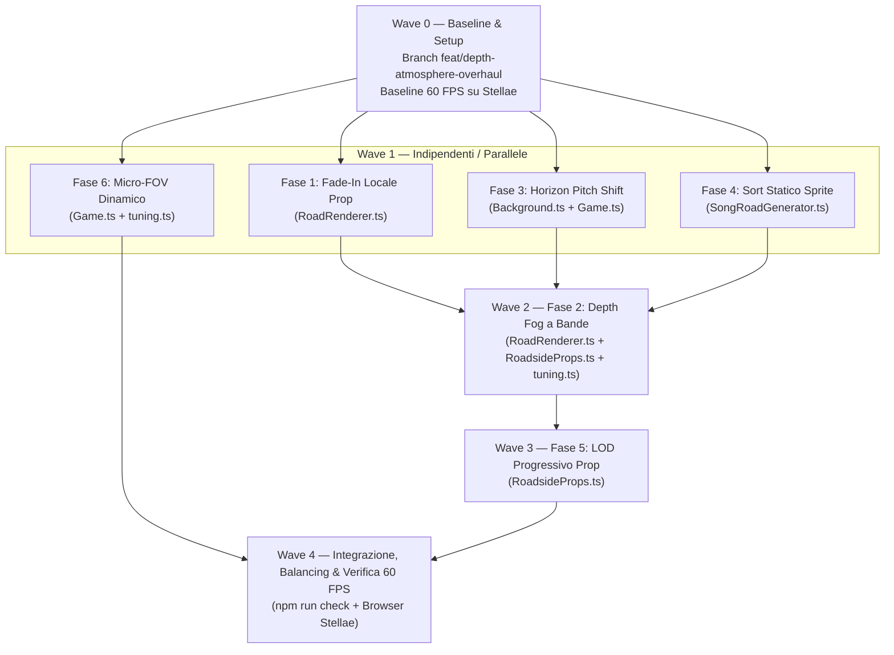

# Piano di Implementazione: Depth & Atmosphere Overhaul (6 Fasi)

> **Documento orchestrabile** progettato per l'esecuzione coordinata tramite orchestratore multi-agente su un unico branch di feature coeso (`feat/depth-atmosphere-overhaul`, staccato da `develop`), in conformità con [`AGENTS.md`](../AGENTS.md).

---

## 1. Obiettivo e Visione (Yu Suzuki Ethos)

Con la `v0.3.4-alpha` il rasterizer Pseudo-3D ha raggiunto **60 FPS stabili**, terreno opaco ancorato sui dislivelli e carreggiata priva di artefatti stroboscopici. Tuttavia, la lettura della profondità presenta ancora sei margini di miglioramento concreti:

1. **Pop-in secco di categorie di prop:** i prop tagliati a mezza distanza (`Band D` a 45%, piccoli a 55%, medi a 65%) entrano in scena al 100% di opacità perché il fade-in attuale (`propAlpha`) agisce solo sull'ultimo 18% della `drawDistance`.
2. **Assenza di prospettiva atmosferica reale:** `seg.fog` è fisso a `1`; asfalto, cordoli, terreno e prop lontani mantengono gli stessi colori saturi del primo piano, mentre la sola trasparenza `globalAlpha` rende i prop lontani simili a "ologrammi" davanti a luna e skyline.
3. **Orizzonte dello sfondo statico sui dislivelli:** `horizonY` in `Background.ts` resta inchiodato a `height / 2` anche sulle salite ripide o in scollinamento.
4. **Sovrapposizioni laterali intra-segmento:** se uno stesso segmento ospita prop in Band A/B e Band C/D sullo stesso lato, l'ordine di disegno dipende dall'ordine di inserimento e non dalla distanza laterale dalla carreggiata.
5. **Scatti di dettaglio nei LOD dei prop:** le soglie Low → Mid → Full in `RoadsideProps.ts` accendono più dettagli contemporaneamente sullo stesso frame.
6. **Sensazione di velocità longitudinale in OVERDRIVE / Perfect Beat-Shift:** il FOV è statico (`tuning.fieldOfView = 100`), sprecando un forte cue percettivo di profondità e flow state.

---

## 2. Guardrail Architetturali Non Negoziabili (`AGENTS.md`)

Ogni agente esecutore **deve** rispettare questi vincoli:

1. **Branch unico coeso (`AGENTS.md §2` & `§4.10`):** tutte e 6 le fasi vanno sviluppate e integrate sullo stesso branch `feat/depth-atmosphere-overhaul` (creato da `develop`), mai frammentate in 6 branch separati. Non committare né pushare su `main`.
2. **Zero React nel Core (`AGENTS.md §2`):** nessuna importazione React in `@src/config/`, `@src/core/`, `@src/engine/`, `@src/road/`, `@src/entities/`.
3. **Zero GC nel Render Loop (`AGENTS.md §4.3`):** **nessuna** allocazione di oggetti, array, stringhe dinamiche o closure dentro `render()`, `project()`, `drawProp()` o `update()`. Tutte le bande fog, le cache colore e i buffer temporanei devono essere pre-allocati e invalidati solo al cambio palette/altezza.
4. **Determinismo intatto (`AGENTS.md §4.6`):** `generateSongRoad(beatMap, seed)` deve restare 100% deterministico; l'ordinamento della Fase 4 deve essere stabile e replicabile.
5. **Budget 60 FPS bloccati (`AGENTS.md §5`):** nessuna fase può introdurre `ctx.clip()` extra sui dossi terrestri, `ctx.filter`, gradienti allocati per frame o aumenti significativi di draw call.
6. **Toggle di diagnostica / A/B:** preservare `view.legacyRaster` e l'API `window.__MAYONAKA_DIAG__` funzionanti.

---

## 3. Orchestrazione, Dipendenze e Mappa di Proprietà dei File

Per evitare conflitti di merge in caso di esecuzione multi-agente, le 6 fasi sono organizzate in **3 Wave di esecuzione**:



### Matrice di Proprietà dei File (Anti-Conflitto)

| Fase | File Primari (Ownership) | File Condivisi (Coordinare) | Dipende da |
| :--- | :--- | :--- | :--- |
| **Fase 1** | `src/road/RoadRenderer.ts`, `src/road/RoadRenderer.test.ts` | — | Wave 0 |
| **Fase 2** | `src/road/RoadRenderer.ts`, `src/road/RoadsideProps.ts` | `src/config/tuning.ts`, `src/road/RoadRenderer.test.ts` | Fase 1 |
| **Fase 3** | `src/engine/Background.ts`, `src/engine/Background.test.ts` | `src/engine/Game.ts`, `src/config/tuning.ts` | Wave 0 |
| **Fase 4** | `src/road/SongRoadGenerator.ts`, `src/road/SongRoadGenerator.test.ts` | — | Wave 0 |
| **Fase 5** | `src/road/RoadsideProps.ts`, `src/road/RoadsideProps.test.ts` | — | Fase 2 |
| **Fase 6** | `src/engine/Game.ts`, `src/engine/Game.test.ts` | `src/config/tuning.ts` | Wave 0 (merge pulito dopo Fase 3 su `Game.ts`) |

> **Consiglio per l'Orchestratore:** se lanci Fase 3 e Fase 6 in parallelo, assegna a un unico passo di integrazione (o sequenzia Fase 3 → Fase 6) i pochi punti di contatto in `src/engine/Game.ts` e `src/config/tuning.ts`. Allo stesso modo, sequenzia rigorosamente **Fase 1 → Fase 2 → Fase 5** perché condividono `RoadRenderer.ts` e `RoadsideProps.ts`.

---

## 4. Specifiche Tecniche Dettagliate per Fase

---

### Fase 1 — Fade-In Locale per Categoria di Prop (Eliminazione Pop-In)

#### Problema & Obiettivo
Attualmente in [`src/road/RoadRenderer.ts`](../src/road/RoadRenderer.ts#L386-L469):
- `distAlpha` sfuma solo per `n > drawDistance * 0.82` (`n = 164..200`).
- Le soglie di culling tagliano seccamente a `n > 0.45 * drawDistance` (Band D), `n > 0.55 * drawDistance` (prop piccoli) e `n > 0.65 * drawDistance` (prop medi e Band C non-building/non-pylon), oltre ai cutoff `propRefPpu < 0.011` / `0.0095`.
- Di conseguenza, tutti questi prop passano da `0%` (saltati) a `100%` (opachi) in un solo frame.

#### Specifiche Implementative
1. **Funzione helper zero-GC per categoria di distanza in `RoadRenderer.ts`:**
   Definire per ciascun prop la coppia `(maxRatio, minRefPpu, fadeRatioSpan, fadePpuSpan)` senza allocare oggetti (usando scalari locali nel loop):
   - **Band D (`|offset| >= 6.0`):** `maxRatio = 0.50`, `fadeRatioSpan = 0.12`, `minRefPpu = 0.0095`, `fadePpuSpan = 0.004`.
   - **Prop piccoli (`shrub`, `bench`, `chevron`, `jihanki`, `phonebooth`, `bus-stop`):** `maxRatio = 0.58`, `fadeRatioSpan = 0.12`, `minRefPpu = 0.0095`, `fadePpuSpan = 0.004`.
   - **Prop medi (`sign`, `lamp`, `toro`, `kiosk`, `canopy`) e Band C non-building/non-pylon (`|offset| >= 3.0`):** `maxRatio = 0.68`, `fadeRatioSpan = 0.12`, `minRefPpu = 0.0085`, `fadePpuSpan = 0.0035`.
   - **Prop grandi (`building`, `pylon`, `gantry`, `overpass`, `suspension-tower`, alberi/billboard Band A/B):** `maxRatio = 1.0`, `fadeRatioSpan = 0.18`, `minRefPpu = 0.004`, `fadePpuSpan = 0.003`.
2. **Calcolo alpha locale per singolo prop:**
   - Sia `nRatio = n / Math.max(1, drawDistance)`.
   - Se `nRatio >= maxRatio || propRefPpu <= minRefPpu`: `continue` (cull immediato, identico costo di prima).
   - Altrimenti:
     ```ts
     const localDistAlpha =
       nRatio > maxRatio - fadeRatioSpan
         ? clamp01((maxRatio - nRatio) / fadeRatioSpan)
         : 1;
     const localPpuAlpha =
       propRefPpu < minRefPpu + fadePpuSpan
         ? clamp01((propRefPpu - minRefPpu) / fadePpuSpan)
         : 1;
     const effectiveAlpha = Math.min(propAlpha, localDistAlpha, localPpuAlpha);
     if (effectiveAlpha < 0.04) continue;
     ```
3. **Minimizzazione state-churn di `ctx.globalAlpha`:**
   - Tenere traccia di `let activeAlpha = 1;` nel loop dei prop del segmento e impostare `ctx.globalAlpha = targetAlpha` **solo se** `Math.abs(targetAlpha - activeAlpha) > 0.02`, ripristinando `ctx.globalAlpha = 1` una sola volta a fine segmento se `activeAlpha !== 1`.
4. **Invarianti:**
   - In modalità `legacyRaster = true`, preservare esattamente il comportamento legacy esistente.
   - Mantenere intatti tutti i test di fade-in esistenti (`RoadRenderer.test.ts`).

#### Test Obbligatori (`src/road/RoadRenderer.test.ts`)
- Verificare che un `lamp` appena dentro la soglia `n = Math.floor(drawDistance * 0.64)` venga disegnato con `globalAlpha` in `(0, 0.7)` (non `1.0`) e che a `n = Math.floor(drawDistance * 0.40)` venga disegnato con `globalAlpha === 1`.
- Verificare lo stesso comportamento per un prop `jihanki` (fascia piccoli) e per un `building` di Band D (`offset: 7.0`).
- Verificare che `ctx.globalAlpha` venga sempre ripristinato a `1` al termine del segmento.

#### Criteri di Accettazione (DoD)
- Zero pop-in bruschi di lampioni, cartelli, `jihanki`, cespugli e grattacieli Band D.
- Nessun aumento significativo di `drawnProps` né di `renderTimeMs` rispetto alla baseline.

---

### Fase 2 — Prospettiva Atmosferica a Bande (*Depth Fog* su Strada, Terreno e Silhouette Prop)

#### Problema & Obiettivo
Attualmente:
- `seg.fog` è hardcodato a `1` ([`RoadRenderer.ts:218`](../src/road/RoadRenderer.ts#L218)).
- Strada, cordoli, linee di corsia ed erba mantengono colori identici vicino e lontano (eccetto l'ultimo strato `isCoalesced`).
- I prop lontani usano `globalAlpha < 1`, lasciando trasparire la luna e la skyline attraverso edifici e cartelloni (effetto fantasma).

#### Specifiche Implementative

##### 2.1 Parametri di Tuning (`src/config/tuning.ts`)
- Verificare l'uso di `fogDensity` esistente (`DEFAULT_TUNING.fogDensity = 5`, già esposto in `RoadView.fogDensity`) e aggiungere in `DEFAULT_TUNING` + `TUNING_CONTROLS` (gruppo `Camera & Road`):
  - `roadFogStrength: 0.65` (range `0..1`, step `0.05`) — Intensità del blending atmosferico verso `palette.fog` sulle bande medie/lontane di strada e terreno.
  - `propAtmosphereFog: 0.75` (range `0..1`, step `0.05`) — Intensità della tinta atmosferica (silhouette) sui prop lontani prima del fade-in finale.

##### 2.2 Palette Fog Pre-Calcolata a 4 Bande in `RoadRenderer.ts` (Zero GC)
Pre-allocare una tabella fissa di **4 bande di profondità** (`FOG_BANDS = 4`, indici `0..3`), ricalcolata **solo** quando cambiano i colori della `StagePalette` o `tuning.roadFogStrength` (in modo da gestire anche il crossfade fluido tra stage in `blendStagePalette` senza allocare array):

- **Banda 0 (Near, `tFog = 0.00`):** `nRatio < 0.25` → colori originali 100% puri (`palette.grass`, `palette.road`, `palette.rumble`, `palette.lane`).
- **Banda 1 (Mid-Near, `tFog = 0.22 * strength`):** `0.25 <= nRatio < 0.50` → leggera velatura verso `palette.fog`.
- **Banda 2 (Mid-Far, `tFog = 0.48 * strength`):** `0.50 <= nRatio < 0.75` → cordoli e asfalto si attenuano nell'atmosfera notturna/tramonto, riducendo contrasto eccessivo in lontananza.
- **Banda 3 (Far, `tFog = 0.72 * strength`):** `nRatio >= 0.75` → quasi fusi con `palette.fog` e col `cachedHorizonCurbColor` già esistente.

Strutture pre-allocate nella classe `RoadRenderer` (zero allocazioni a frame):
```ts
private readonly fogGrass0 = ['', '', '', ''];
private readonly fogGrass1 = ['', '', '', ''];
private readonly fogRoad0 = ['', '', '', ''];
private readonly fogRoad1 = ['', '', '', ''];
private readonly fogRumble0 = ['', '', '', ''];
private readonly fogRumble1 = ['', '', '', ''];
private readonly fogLane = ['', '', '', ''];
private cachedFogPaletteKey = ''; // oppure confronto diretto scalare su 8 stringhe + strength + palette.fogDensity
```
> **Importante (Zero GC):** confrontare i singoli campi scalari (come già fatto per `cachedHorizonFog`, `cachedHorizonRumble0`, ecc.) invece di concatenare una template string ogni frame!
> Tenere conto anche di `palette.fogDensity ?? 1.0` (es. `PALETTE_VAPORFUNK` ha `fogDensity: 1.35`, `PALETTE_AKIBA_NIGHT` ha `0.85`): moltiplicare `tFog` per `palette.fogDensity` e clampare in `[0, 0.88]`.

Applicare la banda di fog anche in `renderForkSegment()` così i bivi non "staccano" cromaticamente rispetto alla strada che li precede.

##### 2.3 Silhouette Atmosferica per Prop Lontani (`RoadsideProps.ts` & `RoadRenderer.ts`)
Sostituire l'effetto "fantasma semitrasparente" sui prop lontani (`nRatio > 0.55` o Low LOD lontano) con una resa atmosferica coerente:
1. Aggiungere in `RoadsideProps.ts` uno stato modulo zero-GC (come `activePropTheme`):
   ```ts
   export interface PropAtmosphere {
     fogColor: string;
     silhouetteColor: string; // es. lerpHexColor(palette.mountain, palette.fog, 0.45)
     accentColor: string;     // es. lerpHexColor(palette.mountainRim, palette.fog, 0.55)
   }
   export function setPropAtmosphere(fogColor: string, silhouetteColor: string, accentColor: string): void;
   ```
   Aggiornato 1 volta per frame in `RoadRenderer.render()` insieme a `setPropTheme(palette.scenery)` (con caching scalare per evitare `lerpHexColor` ridondanti).
2. Estendere `drawProp(..., fogFactor = 0)`:
   - `fogFactor` in `[0, 1]` calcolato in `RoadRenderer.ts` in base alla distanza relativa del prop (`0` vicino, fino a `tuning.propAtmosphereFog` vicino alla sua soglia di ingresso).
   - Quando `fogFactor >= 0.55` (fascia lontana / Low LOD): i prop principali (`building`, `palm`, `street-tree`, `pine`, `billboard`, `lamp`, `gantry`, `overpass`, `pylon`, `suspension-tower`) usano `silhouetteColor` per le masse strutturali e `accentColor` (smorzato) per le finestre/insegne invece dei neon puri `#ff007f` / `#ffee32`.
   - Risultato: i prop lontani restano **opachi e solidi** (non lasciano trasparire la luna dietro i palazzi!), ma risultano immersi nella foschia atmosferica; poi il fade-in locale della Fase 1 si limita agli ultimi ~8–10 segmenti estremi per evitare lo scatto d'ingresso.

#### Test Obbligatori
- `RoadRenderer.test.ts`:
  - Verificare che segmenti in Banda 0 (`n < 25%`) usino esattamente `palette.road[stripe]` / `palette.rumble[stripe]` mentre segmenti in Banda 2–3 (`n > 60%`) usino colori interpolati verso `palette.fog` diversi dai colori pieni.
  - Verificare che `roadFogStrength = 0` disattivi il fog (colori puri su tutta la pista).
  - Verificare che `PALETTE_VAPORFUNK` (`fogDensity: 1.35`) produca una tinta più vicina a `palette.fog` rispetto a `PALETTE_AKIBA_NIGHT` (`fogDensity: 0.85`).
- `RoadsideProps.test.ts`:
  - Verificare che `drawProp(..., fogFactor = 0.8)` per `building`, `billboard`, `palm` usi `silhouetteColor` invece dei colori neon saturi.

#### Criteri di Accettazione (DoD)
- Asfalto, cordoli ed erba sfumano morbidamente nell'orizzonte su tutte e 3 le palette (`MAYONAKA BAY`, `SUNSET BOULEVARD`, `AKIBA NIGHT RUSH`).
- Gli edifici e i cartelloni lontani non sembrano più ologrammi trasparenti davanti alla luna.
- Zero allocazioni per frame nel render loop; `renderTimeMs <= 1.2 ms`.

---

### Fase 3 — Parallasse Verticale Smorzata dello Sfondo sui Dislivelli (*Horizon Pitch Shift*)

#### Problema & Obiettivo
In [`src/engine/Background.ts:749`](../src/engine/Background.ts#L749), `const horizonY = Math.floor(height * 0.5);` è fisso a `180`. Quando l'auto sale o scende una collina, lo sfondo non reagisce verticalmente.

#### Specifiche Implementative
1. **Parametri in `src/config/tuning.ts`:**
   - `bgPitchStrength: 1.0` (range `0..2`, step `0.1`) — Intensità dello spostamento verticale dello sfondo sui dislivelli (`0` = orizzonte fisso classico).
   - `bgPitchMaxPx: 18` (range `0..32`, step `1`) — Massimo spostamento verticale in pixel (`±18 px` su `360 px` di altezza).
2. **Stato smorzato e interpolato in `src/engine/Background.ts` (Zero GC):**
   - Aggiungere campi scalari:
     ```ts
     public pitchOffset = 0;
     public prevPitchOffset = 0;
     ```
   - Estendere `Background.update(dt, segmentCurve, speedRatio, extremeSpectralEventOrDownbeat = false, roadSlope = 0)`:
     - `roadSlope` è la pendenza normalizzata sotto l'auto: `(playerSeg.p2.worldY - playerSeg.p1.worldY) / segmentLength`.
     - Target smorzato:
       ```ts
       const rawTarget = clamp(
         roadSlope * 28 * tuning.bgPitchStrength,
         -tuning.bgPitchMaxPx,
         tuning.bgPitchMaxPx,
       );
       // Salita (roadSlope > 0) -> l'orizzonte dello sfondo scende leggermente (+offset) o sale?
       // Verifica ottica: in salita il naso dell'auto guarda verso l'alto, quindi la linea dell'orizzonte
       // scende leggermente nello schermo (horizonY aumenta -> vedi più cielo e luna sopra la collina!).
       // In discesa (roadSlope < 0) l'auto guarda verso il basso, quindi l'orizzonte sale leggermente (-offset).
       this.prevPitchOffset = this.pitchOffset;
       this.pitchOffset += (rawTarget - this.pitchOffset) * Math.min(1, dt * 4.5);
       ```
     - **ATTENZIONE CRITICA ALL'ACCOPIAMENTO CON `RoadRenderer`:**
       Se `Background.ts` sposta `horizonY` verso il basso (`horizonY_bg = 180 + 14 = 194`) mentre il terreno della strada in pianura parte da `183.6`, potrebbe crearsi una striscia di cielo sotto la fine della strada se non gestita!
       **Regola di sicurezza geometrica (OBBLIGATORIA):**
       - Il cielo, le stelle, la luna, le nuvole, il mare, le montagne e la skyline si spostano con `bgHorizonY = Math.round(baseHorizonY + renderPitchOffset)`.
       - Il **fallback ground fill** di `Background.ts` (Step 5, riga 993) deve invece coprire **sempre** da `Math.min(baseHorizonY, bgHorizonY)` fino a `height`!
       - E in salita (`roadSlope > 0`, quindi `bgHorizonY > baseHorizonY`), la collina reale disegnata da `RoadRenderer` sta già *sopra* `baseHorizonY` (`y2 < 180`), quindi copre completamente `baseHorizonY..bgHorizonY`! Per sicurezza assoluta (es. se il giocatore è all'inizio di una salita e vede ancora tratti lontani a `y ≈ 183`), limitare lo spostamento verso il basso a `Math.min(bgPitchMaxPx, 10)` oppure far estendere il gradiente del mare/skyline leggermente oltre `bgHorizonY` e garantire che `cachedGroundGrad` riempia fino a `height` senza mai lasciare fessure.
       - **Ancora più pulito (zero rischi di fessure):** applicare la parallasse verticale per strati con **pesi differenziati** sopra un `baseHorizonY` invariato per il ground fill:
         - Stelle & nuvole: `1.0 × renderPitchOffset`
         - Sole / Luna & corona: `0.75 × renderPitchOffset`
         - Montagne / colline & mare: `0.45 × renderPitchOffset` (ancorate con base estesa fino a `baseHorizonY + maxPitch + 4` così non si staccano mai dal terreno!)
         - Skyline cittadino: `0.30 × renderPitchOffset` (base estesa di `+maxPitch` sotto `skylineBaseY` così gli edifici non "volano" mai quando salgono/scendono!).
       - **In questo modo `cachedSkyGrad` / `cachedGroundGrad` non vengono nemmeno invalidati ogni frame!** Zero ricostruzione di `CanvasGradient`, zero fessure possibili, effetto parallasse 3D verticale stupendo!
3. **Passaggio pendenza in `src/engine/Game.ts`:**
   - Nel fixed-step `update(dt)`, calcolare `const roadSlope = (playerSeg.p2.worldY - playerSeg.p1.worldY) / this.track.segmentLength;` e passarlo come 5° argomento a `this.background.update(...)`.

#### Test Obbligatori (`src/engine/Background.test.ts`)
- Verificare che `pitchOffset` sia `0` su strada piatta (`roadSlope = 0`).
- Verificare che su salita sostenuta (`roadSlope > 0`) `pitchOffset` converga fluidamente verso un valore positivo limitato a `tuning.bgPitchMaxPx`, e su discesa (`roadSlope < 0`) verso un valore negativo simmetrico.
- Verificare che con `bgPitchStrength = 0` `pitchOffset` resti `0`.
- Verificare che **nessun `createLinearGradient` venga riallocato** durante variazioni continue di `roadSlope` (zero-GC gradient cache invariant).

#### Criteri di Accettazione (DoD)
- Su salite e scollinamenti (es. `BUILD` e `DROP` di `Stellae`), luna, montagne e skyline respirano verticalmente con parallasse multi-livello senza mai creare fessure luminose sopra il terreno o invalidare le cache dei gradienti.

---

### Fase 4 — Ordinamento Laterale Statico Intra-Segmento (`|offset|` decrescente)

#### Problema & Obiettivo
Quando un singolo `RoadSegment` contiene più prop sullo stesso lato (es. un `building` in Band C a `offset = +4.2`, una `palm` in Band B a `offset = +2.3` e un `lamp` in Band A a `offset = +1.3`), l'array `seg.sprites` viene disegnato nell'ordine in cui le varie passate del generatore (chunk rules, vignettes, corridors, chevrons) hanno fatto `.push()`. Se un prop esterno viene pushato dopo un prop interno, copre il prop più vicino alla strada.

#### Specifiche Implementative
1. **Passata finale deterministica in `src/road/SongRoadGenerator.ts`:**
   - Al termine di `generateSongRoad()`, **dopo** chunk props, chevrons/warning signs, power line corridors e vignettes — e **prima** di scattare lo snapshot `canonical` (così anche gli stitch A2 ereditano l'ordine corretto!):
     ```ts
     for (let i = 0; i < segments.length; i++) {
       const sprites = segments[i]!.sprites;
       if (sprites.length > 1) {
         sprites.sort((a, b) => {
           const diff = Math.abs(b.offset) - Math.abs(a.offset);
           if (Math.abs(diff) > 1e-6) return diff;
           // Tie-breaker deterministico: strutture aeree (gantry/overpass/suspension-tower) per ultime
           const aOverhead = isOverheadProp(a.kind) ? 1 : 0;
           const bOverhead = isOverheadProp(b.kind) ? 1 : 0;
           if (aOverhead !== bOverhead) return aOverhead - bOverhead;
           return a.offset - b.offset;
         });
       }
     }
     ```
   - `isOverheadProp(kind)`: ritorna `true` per `'gantry' | 'overpass' | 'suspension-tower'`.
2. **Stessa passata in `src/road/TrackBuilder.ts`** (se usata dalla pista di test/fallback) tramite helper condiviso `sortSegmentSprites(segments)` esportato da `RoadSegment.ts` o `SongRoadGenerator.ts`.
3. **Costo a runtime:** **0.00 ms** (eseguito una sola volta alla generazione della pista).

#### Test Obbligatori (`src/road/SongRoadGenerator.test.ts`)
- Verificare che per ogni segmento generato con `sprites.length > 1`, `Math.abs(sprites[k].offset) >= Math.abs(sprites[k + 1].offset)` (a meno di override overhead).
- Verificare che il determinismo per seed (`generateSongRoad(beatMap, { seed })`) rimanga identico al 100% e che `canonical.sprites` conservi lo stesso ordine.

#### Criteri di Accettazione (DoD)
- Nessun edificio Band C/D si sovrappone mai a un lampione, cartello o albero Band A/B posizionato sullo stesso segmento.
- Zero regressioni sui test di determinismo e di horizon stitching A2.

---

### Fase 5 — Rivelazione Progressiva dei Dettagli LOD nei Prop

#### Problema & Obiettivo
In [`src/road/RoadsideProps.ts`](../src/road/RoadsideProps.ts), i prop più frequenti (`drawBuilding`, `drawLamp`, `drawBillboard`, `drawStreetTree`, `drawPalm`, `drawPine`, `drawGantry`) usano 1–2 `if (...) return;` netti che accendono di colpo 6–10 elementi grafici tutti allo stesso frame (finestre, insegne verticali, tende, ombre, aloni).

#### Specifiche Implementative
Ristrutturare i 4–5 prop più visibili per introdurre **soglie scaglionate a cascata** (senza aumentare il numero di rettangoli in Low/Mid LOD e mantenendo intatta la silhouette atmosferica della Fase 2):

1. **`drawBuilding` (tutte e 3 le varianti architettoniche):**
   - `h < 30` (Far / Atmospheric): corpo edificio + fascia tetto/trim (`2–3 rect`, tinta atmosferica se `fogFactor >= 0.55`).
   - `30 <= h < 52` (Mid-Far): accende 2–3 fasce finestre orizzontali e insegna principale.
   - `52 <= h < 85` (Mid-Near): aggiunge tenda/shopfront a piano terra e beacon sul tetto.
   - `h >= 85` (Near / Full): dettagli completi (griglia finestre/kanji, insegna verticale dettagliata, cornice neon).
2. **`drawLamp`:**
   - `h < 22`: palo 1px + punto luce 3×1.
   - `22 <= h < 42`: palo scalato + braccio a sbalzo + testa lampada.
   - `42 <= h < 64`: aggiunge plinto alla base e bordo illuminato sul palo.
   - `h >= 64` (e `ppu >= 0.016`): aggiunge diagonale di supporto e alone luminoso morbido.
3. **`drawBillboard`:**
   - `w < 18`: gambe + cornice + pannello tinta atmosferica/base.
   - `18 <= w < 34`: aggiunge faccia colorata interna e barra orizzontale gambe.
   - `w >= 34`: aggiunge grafica interna (Melon Soda / EQ / Cassette), faretti superiori e passerella inferiore.
4. **`drawStreetTree` / `drawPalm` / `drawPine`:**
   - Scaglionare separatamente l'apparizione di: (a) chioma/tronco base, (b) riflesso lunare/rim sulla chioma, (c) fioriera/ombra a terra (solo in primo piano `ppu >= 0.018`).
5. **`drawGantry`:**
   - `spanW < 55`: piloni + trave + 2 pannelli verdi base.
   - `55 <= spanW < 95`: aggiunge bordi bianchi dei cartelli e luce trave.
   - `spanW >= 95`: aggiunge plinti a terra e glifi/frecce bianche.

#### Test Obbligatori (`src/road/RoadsideProps.test.ts`)
- Verificare monotonicità del dettaglio per `building`, `lamp`, `billboard`, `gantry`: al crescere di `ppu` (`0.005 → 0.010 → 0.018 → 0.035`), il numero di chiamate `fillRect` cresce progressivamente senza salti estremi né crash per `ppu` minuscoli/enormi.
- Verificare che a `ppu` lontano (`0.006`) il numero di `fillRect` resti compatto (es. `<= 8` per `building`, `<= 4` per `lamp`) per proteggere i 60 FPS.

#### Criteri di Accettazione (DoD)
- Avvicinandosi a città, viali alberati e cartelloni, i dettagli emergono in modo progressivo e naturale anziché "scattare" in blocco.
- Costo GPU di `RoadsideProps` invariato o inferiore.

---

### Fase 6 — Micro-FOV Dinamico in OVERDRIVE e su Perfect Beat-Shift

#### Problema & Obiettivo
In [`src/engine/Game.ts:1473`](../src/engine/Game.ts#L1473):
```ts
this.view.cameraDepth = cameraDepthFromFov(tuning.fieldOfView);
```
Il FOV è completamente statico. Un micro-allargamento elastico del FOV legato allo stato di flow (**speed ratio + OVERDRIVE + impulso breve su Perfect Beat-Shift / Clean Drift Boost**) amplifica enormemente la percezione della profondità e della velocità laterale (esattamente nello spirito *Feel Over Simulation* di `AGENTS.md §1`), a costo computazionale **zero**.

#### Specifiche Implementative
1. **Parametri in `src/config/tuning.ts` (gruppo `Camera & Road`):**
   - `dynamicFovSpeedBonus: 4.0` (range `0..12`, step `0.5`) — Gradi FOV extra a velocità massima (`speedRatio = 1`).
   - `dynamicFovOverdriveBonus: 3.5` (range `0..10`, step `0.5`) — Gradi FOV extra sostenuti durante tier `OVERDRIVE`.
   - `dynamicFovBoostKick: 3.0` (range `0..8`, step `0.5`) — Impulso FOV temporaneo su `PERFECT` beat-shift o clean drift exit boost (decade esponenzialmente in ~0.35s).
2. **Stato smorzato e interpolato in `src/engine/Game.ts` (Zero GC):**
   - Aggiungere scalari in `Game`:
     ```ts
     private dynamicFov = DEFAULT_TUNING.fieldOfView;
     private prevDynamicFov = DEFAULT_TUNING.fieldOfView;
     private fovBoostPulse = 0;
     ```
   - Nei punti in cui scatta un `PERFECT` beat-shift o un clean drift exit boost: `this.fovBoostPulse = 1.0;`.
   - In `update(dt)`:
     ```ts
     this.prevDynamicFov = this.dynamicFov;
     this.fovBoostPulse = Math.max(0, this.fovBoostPulse - dt * 2.8);
     const speedRatio = Math.max(0, Math.min(1, this.car.speed / Math.max(1, tuning.maxSpeed)));
     const overdriveFactor = this.car.grooveTier === 'OVERDRIVE' ? 1 : 0;
     const targetFov = Math.min(
       122, // safety cap anti-distorsione
       tuning.fieldOfView +
         speedRatio * speedRatio * tuning.dynamicFovSpeedBonus +
         overdriveFactor * tuning.dynamicFovOverdriveBonus +
         this.fovBoostPulse * tuning.dynamicFovBoostKick,
     );
     // Smoothing asimmetrico: entrata reattiva, rilascio morbido (niente mal di mare)
     const rate = targetFov > this.dynamicFov ? 6.5 : 3.2;
     this.dynamicFov += (targetFov - this.dynamicFov) * Math.min(1, dt * rate);
     ```
   - In `render(ctx, alpha)`:
     ```ts
     const renderFov = interpolate(this.prevDynamicFov, this.dynamicFov, alpha);
     this.view.cameraDepth = cameraDepthFromFov(renderFov);
     ```
   - Reset su `restartPlaylistRun()` / nuova corsa: `this.dynamicFov = this.prevDynamicFov = tuning.fieldOfView; this.fovBoostPulse = 0;`.
3. **Invariante importante (collisioni e gameplay):**
   - La simulazione fisica usa `playerZ = cameraHeight * cameraDepth` solo in `RoadRenderer` (camera visiva) e non modifica la fisica dei binari né il sync spazio-tempo (`Spacetime Sync`). Verificare comunque in `Game.ts` se `cameraDepth` viene letto altrove in `update()` — usare il FOV base per la fisica se necessario, così il micro-FOV è **100% visivo e non altera la fisica né le hitbox**.

#### Test Obbligatori (`src/engine/Game.test.ts`)
- Verificare che a fermo (`speed = 0`, `LOW` groove) il FOV renderizzato sia uguale a `tuning.fieldOfView`.
- Verificare che in velocità + `OVERDRIVE` il `cameraDepth` scenda (FOV maggiore) e resti entro il safety cap (`<= 122°`).
- Verificare che un `PERFECT` beat-shift generi un aumento temporaneo del FOV che rientra dolcemente dopo ~0.5–1.0s.
- Verificare che azzerando i 3 parametri (`0`) il FOV resti bloccato a `tuning.fieldOfView`.

#### Criteri di Accettazione (DoD)
- In `OVERDRIVE` e sui `PERFECT` beat-shift la strada "respira" verso l'esterno con un senso di spinta palpabile ma mai nauseante.
- Zero impatto su `Spacetime Sync`, hitbox o `renderTimeMs`.

---

## 5. Piano di Verifica Finale e Performance Gate (`AGENTS.md §5`)

Prima di aprire la PR verso `develop`, l'orchestratore (o un agente Verificatore dedicato) **deve** eseguire tutti questi controlli in ordine:

### 5.1 Gate Statico e Suite Completa
```bash
npm run check
```
Deve terminare con `exit code 0`:
- `eslint .` (zero warning/error, inclusi i boundary `no-restricted-imports`)
- `vitest run` (tutti i test esistenti + tutti i nuovi test delle 6 fasi)
- `tsc --noEmit && vite build`

### 5.2 Verifica Visiva e Benchmark 60 FPS dal Vivo nel Browser
Avviare `npm run dev` e testare su una traccia reale del corpus (`Stellae` in `test-tracks/`):
- URL: `http://localhost:5173/?autostart&profiler&autopilot&track=stellae`
- Raccogliere `[data-testid="perf-report-json"]` (o `window.__MAYONAKA_DIAG__.getFullReport()`) su una corsa completa (`INTRO` → `BUILD` → `DROP` → `BREAKDOWN` → `FORK` → stage successivo).

#### Soglie Performance Obbligatorie
| Metrica | Soglia Target |
| :--- | :--- |
| `sessionAvgFps` | `>= 59.0` |
| `p95FrameMs` | `<= 16.7 ms` |
| `pct60Fps` | `>= 98%` |
| `renderTimeMs` (JS) | `<= 1.5 ms` |
| `roadRenderMs` | `<= 0.9 ms` |
| `crestClips` (su tratti non-ponte) | `0` |

#### Checklist Visiva Obbligatoria (su tutte e 3 le palette: tasti `1`, `2`, `3` con DebugPanel aperto)
- [ ] **Nessun pop-in secco:** lampioni, `jihanki`, cartelli, cespugli e grattacieli Band D entrano morbidamente.
- [ ] **Profondità atmosferica:** asfalto, cordoli ed erba sfumano naturalmente verso `palette.fog`; i prop lontani non sembrano ologrammi semitrasparenti davanti alla luna/sole.
- [ ] **Salite & discese:** la collina resta 100% solida con prop ancorati a terra; lo sfondo applica una leggera parallasse verticale senza mai mostrare fessure luminose sopra il terreno.
- [ ] **Ponti sospesi (`env === 'bridge'`):** acqua della baia visibile, `crestClips` attivo solo sul ponte, nessuna fascia C/D sul ponte.
- [ ] **Sovrapposizioni laterali:** nessun edificio Band C/D copre lampioni/alberi Band A/B dello stesso segmento.
- [ ] **LOD progressivo:** avvicinandosi agli edifici e cartelloni, dettagli e finestre appaiono gradualmente senza "scatti".
- [ ] **OVERDRIVE & Perfect Shift:** micro-allargamento FOV fluido e controllato, nessun artefatto sui bordi laterali o sui bivi (`FORK`).
- [ ] **Zero strisce epilettiche sull'asfalto:** carreggiata pulita e priva di bleed dei cordoli su rettilinei, curve, salite e bivi.

---

## 6. Prompt Template Pronto per l'Orchestratore

```text
Implementa il piano completo descritto in `docs/DEPTH_ATMOSPHERE_OVERHAUL_PLAN.md`
seguendo rigorosamente le regole di `AGENTS.md`:
1. Crea un unico branch `feat/depth-atmosphere-overhaul` a partire da `develop`.
2. Registra una baseline 60 FPS + screenshot su `Stellae` prima di iniziare.
3. Esegui le 6 fasi rispettando le Wave di dipendenza:
   - Wave 1: Fase 1, Fase 3, Fase 4, Fase 6 (coordinando i punti di contatto su `Game.ts` e `tuning.ts`).
   - Wave 2: Fase 2 (dopo Fase 1, 3, 4).
   - Wave 3: Fase 5 (dopo Fase 2).
4. Aggiungi tutti gli unit test specificati per ciascuna fase e mantieni strict zero-GC nel render loop.
5. Completa la Wave 4: esegui `npm run check` e la verifica visiva + benchmark 60 FPS dal vivo su `Stellae`
   su tutte e 3 le palette, verificando tutte le soglie della Sezione 5.
6. Non fare merge su `main` né deploy senza mia conferma esplicita.
```
