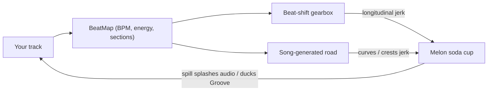

# 真夜中Cassette (Mayonaka Cassette) — Design Spec

> Gameplay source of truth. Architecture rules live in `AGENTS.md`; this file describes **what** the mechanics are and **why**.
> All numbers marked _(start)_ are initial tuning values, to be exposed in `tuning.ts` / DebugPanel.

---

## 1. Core Loop

**Load your songs → each song becomes a road → drive it in sync with the music → forks pick the next song in your playlist.**

The three new mechanics form one closed loop around the music:



---

## 2. Bring Your Own Soundtrack (Core Feature)

### 2.1 Import flow

1. Player drops files / a folder onto `TrackLoader` (or uses the file picker). Supported: whatever `decodeAudioData` handles in the browser (mp3, m4a/aac, wav, ogg, flac on Chromium/Firefox).
2. Hash file bytes (SHA-256 via `crypto.subtle`) → look up cached `BeatMap` in IndexedDB.
3. On cache miss: decode → analyse in worker → show result with confidence → player can correct (×2, ÷2, tap tempo, nudge bar phase).
4. The ordered list of tracks is the **playlist**; it becomes the run's stage sequence.

Files are re-picked each session unless the File System Access API is available (Chromium), in which case directory handles are persisted. BeatMaps are always persisted (they are tiny and contain no audio).

### 2.2 BeatMap schema

```jsonc
{
  "version": 1,
  "contentHash": "sha256:…",          // also the road seed
  "title": "…", "artist": "…",        // from filename / tags when available
  "durationSec": 214.3,
  "bpm": 118.02,                      // refined, not integer-rounded
  "firstBeatOffsetSec": 0.412,        // time of first downbeat (bar 1, beat 1)
  "beatsPerBar": 4,
  "barEnergy": [0.21, 0.24, …],       // 0..1, one per bar, smoothed
  "sections": [                       // snapped to 4-bar boundaries
    { "startBar": 0,  "bars": 16, "role": "intro" },
    { "startBar": 16, "bars": 8,  "role": "build" },
    { "startBar": 24, "bars": 16, "role": "drop" }
  ],
  "confidence": { "tempo": 0.92, "downbeat": 0.71, "tempoStable": true },
  "source": "analysis"                // "analysis" | "manual" | "bundled"
}
```

Section roles: `intro`, `build`, `drop`, `breakdown`, `outro`.

### 2.3 Analysis pipeline (`TrackAnalyzer` + `analysis.worker.ts`)

Runs once per file at import. Future funk is almost always steady-tempo 4/4 and quantized, so we optimise for that case and flag the rest.

| Step            | Method                                                                                                                                                                                                      |
| --------------- | ----------------------------------------------------------------------------------------------------------------------------------------------------------------------------------------------------------- |
| Decode          | `OfflineAudioContext` at 22 050 Hz mono → `Float32Array`, transferred to worker                                                                                                                             |
| Onset envelope  | Log-magnitude spectral flux (half-wave rectified), hop ≈ 5.8 ms; separate low-band (< 150 Hz) kick flux                                                                                                     |
| Coarse tempo    | Autocorrelation of onset envelope over 70–180 BPM with a log-Gaussian prior centred at 120 BPM; keep ×2 / ÷2 candidate scores for the confidence value                                                      |
| Grid refinement | Fit a single constant-tempo grid over the **whole track** (fine search ±0.5 BPM in 0.005 steps + phase), maximising onset alignment. Integer BPM is not enough: 0.1 BPM error drifts ~150 ms over 3 minutes |
| Tempo stability | Alignment score per 8-bar window; if it drops below threshold → `tempoStable: false`                                                                                                                        |
| Downbeat        | Among the 4 beat phases, choose the one with the strongest kick + spectral change on beat 1                                                                                                                 |
| Bar energy      | Per-bar RMS + low-band energy + spectral centroid → normalised, smoothed                                                                                                                                    |
| Sections        | Novelty curve on bar features, boundaries snapped to 4 bars; roles assigned by relative energy and slope (rising → `build`, top tier → `drop`, dip after drop → `breakdown`)                                |

Unstable-tempo tracks remain playable: the road is generated from energy only, and beat-judged mechanics (beat-shift bonus, BPM pulse) are disabled for that song with a toast.

### 2.4 M3a validation corpus & exit criteria

Local corpus in `test-tracks/` (gitignored), 15 tracks, with `test-tracks/ground-truth.json`:

```json
{
  "tracks": [
    { "file": "example.mp3", "bpm": 120, "firstDropSec": 45.2, "notes": "long beatless intro" }
  ]
}
```

`bpm` is required (from Tunebat / Beatport / tapping); `firstDropSec` and `notes` are optional.

`BeatMapInspector` (`?analyze`) analyses every file, shows detected vs ground truth, plots onset envelope / bar energy / sections, and plays the track with a **click track** on the detected grid (accent on downbeats).

**Exit criteria (all must pass):**

| Check                                                                  | Target                                                   |
| ---------------------------------------------------------------------- | -------------------------------------------------------- |
| Tempo, exact (±0.5 BPM of ground truth)                                | ≥ 12 / 15                                                |
| Tempo, exact or octave error (×2 / ÷2, one-click fixable)              | ≥ 14 / 15                                                |
| Grid drift — click still in sync in the **last 30 s** (listening test) | ≥ 12 / 15                                                |
| Downbeat correct (accent lands on "1", listening test)                 | ≥ 10 / 15 (nudge UI covers the rest)                     |
| First drop detected within ±2 bars (tracks with `firstDropSec`)        | ≥ 70 %                                                   |
| Analysis time for a 4-min track                                        | < 3 s; main thread never blocked > 100 ms besides decode |

If tempo/drift criteria fail: switch import to **tap-tempo-first** (analysis only proposes, player confirms) and simplify sections to energy-only before continuing to M4.

---

## 3. Song-Driven Road (M4)

**Hybrid generation:** a vocabulary of hand-authored `RoadChunks` (4 or 8 bars each), selected and sequenced by the BeatMap, seeded by `contentHash`. Same song → same road, always.

| Section role | Chunk pool                                                           |
| ------------ | -------------------------------------------------------------------- |
| `intro`      | Gentle straights, wide sweepers, scenery establishing                |
| `build`      | Climbs that **crest exactly on the first bar of the following drop** |
| `drop`       | Long fast straights, high-speed sweepers, traffic weaving            |
| `breakdown`  | Technical S-bends, hairpins (drift showcases), dips                  |
| `outro`      | Wind-down sweepers ending at the fork                                |

Rules:

- Chunk intensity scales with `barEnergy` (curve strength, hill amplitude, traffic density).
- Chunks are mirrored/varied with `SeededRandom` so the vocabulary does not repeat visibly.
- Segment distance per bar = `referenceSpeed × barDuration`, where `referenceSpeed` _(start: 0.76 × maxSpeed, calibrated for 3rd gear cruising & A1 pacing)_.

**Song ↔ road sync:** the song is the master clock and drives the progression.

- Driving at reference pace means crests land on drops — reward with a **SYNC** Groove bonus when the player crosses a "drop marker" within ±1 beat of the drop.
- **Hybrid Spacetime Sync (A1 + A2):**
  - **A1 (Micro-Elastic Pacing):** dynamically scales road advancement between `0.84×` and `1.25×` relative to player speed to gently pull crests onto drops and ensure arrival at the fork aligned with the outro.
  - **A2 (Horizon Phase Stitching):** when lag exceeds `1.75` bars outside active drops/forks, the engine seamlessly stitches canonical track segments at the horizon fog line with zero pop-in.
- **Organic Outro Extension (Tape Drag + Dub Delay Wash):**
  - **Stage 1 (Approaching Outro):** If the car lags on approach to the fork, the engine smoothly applies **Tape Drag** (reducing tape playback rate down to `0.85×`) and engages pre-outro dub send.
  - **Stage 2 (Natural End Reached):** If the audio file reaches its natural duration before crossing the fork, rather than an abrupt 8-bar rewind/CD skip, the source gracefully washes out while a BPM-synced **Dub Tape Delay** (dotted-eighth `3/16` echo with low-pass filtering and feedback) rings out until the fork is crossed.
- Running ahead: reaching the fork early starts the 4-bar crossfade early (as a DJ would).

### 3.1 Planned: Chunk Environment Archetypes (Future Scope)

To prevent props from feeling contextually out of place (for instance vending machines appearing along empty mountain touge passes), future iterations will introduce explicit **environment archetypes** (`urbano`, `semiurbano`, `rurale`, `foresta`, `deserto`, `costiero`) on `RoadChunk` definitions. This will govern which vignette prefabs (including re-enabling *jihanki* strictly in urban/semi-urban service zones), roadside buildings, and lateral foliage corridors can co-occur within each chunk. *Jihanki* spawning is temporarily paused until this archetype system is implemented.

---

## 4. Beat-Shift Gearbox (M5)

OutRun had a LOW/HIGH stick; we extend it into a rhythm mechanic without becoming a sim.

- **6 gears**, top-speed ratios `[0.28, 0.46, 0.63, 0.79, 0.91, 1.00] × maxSpeed` (`tuning.gear1MaxRatio` .. `tuning.gear6MaxRatio`).
- `rpm = speed / gearTopSpeed`; fake torque curve peaks around 0.74 rpm with progressive high-gear taper (`tuning.accelTaper`), low-RPM lugging in higher gears, and a soft redline limiter at 1.0 rpm.
- **Beat judgement** on every manual shift (timestamp-based, latency-compensated, AGENTS.md §4.8):
  - `PERFECT` ±50 ms (`tuning.shiftPerfectMs`), `GOOD` ±100 ms (`tuning.shiftGoodMs`); downbeat of a bar counts as a bigger bonus.
  - Only counts when the shift makes sense (upshift at ≥ 0.72 rpm, downshift that keeps rpm < redline) → no spamming.
  - **Reward:** Groove gain (extra on downbeat) + brief low-pass filter "blip" open. **No speed or torque boost** (this is not Mario Kart — Groove is the sole reward).
  - Off-beat shift: works normally, no bonus, **no penalty** (Pillar 3).
- **Auto-shift assist** (option, off by default, toggle `G`): shifts at optimal rpm, earns no beat bonus. In manual mode, coming to a near-stop automatically drops to 1st gear to prevent stalling.
- Each shift produces a longitudinal jerk proportional to the rpm drop → feeds the melon soda glass when Tofu Mode is active (§5).

---

## 5. Dashboard Melon Soda & Tofu Mode (M5)

Our direct Initial D homage with authentic Future Funk flavor: a tall retro-kissaten diner glass of fizzy **Melon Cream Soda** (neon green soda, ice cubes, vanilla ice cream float, and a maraschino cherry) resting in the dashboard cup-holder. The core lesson is **smooth inputs**, so the model reacts to **jerk** (change of acceleration), not acceleration itself.

### 5.1 Tofu Mode (toggle) & Liquid Physics

- Everything related to the Melon Soda cup (inset display, liquid physics, splashes/spills, Groove multiplier, and spill penalty) is active **only while Tofu Mode is enabled** (`T` key or HUD toggle).
- While Tofu Mode is active:
  - **Melon Soda inset** is visible (`120×80` px, bottom-left, drawn on canvas by the engine with pixelated styling).
  - **Groove gain ×2** (`tuning.tofuGrooveMultiplier: 2.0`).
  - Inputs per step: lateral acceleration (steering + centrifugal + drift), longitudinal acceleration (throttle, brake, shifts, collisions), vertical (slope change at crests/dips). Differentiate → jerk `j`.
  - Liquid meniscus / tilt angle = spring-damper: `θ'' = −k·θ − c·θ' + G·j` _(start: tune so a clean committed drift entry gently tilts the soda without spilling; jerky counter-steering, erratic swerving, and panic braking cause a spill)_.
  - `|θ| > spillThreshold` → **spill event**:
    - Droplets of neon green soda splash over the glass rim onto the dashboard tray.
    - Distinct audio feedback: fizzy soda splash + ice cubes clinking against the glass (`clink!`) + brief momentary filter muffle / duck.
    - Costs Groove _(start: −20 % of current tier progress, `tuning.tofuSpillGroovePenaltyPct: 0.2`)_.
    - The beat grid and road sync are never displaced.
- Turning Tofu Mode off hides the inset and ends the multiplier streak. Never a fail state.

### 5.2 Cosmetics & Skins

The neon green **Melon Cream Soda** is the default; unlockable/selectable skins using the same physics include:
- **Classic Tofu Cup:** The plain white paper cup with water from Initial D.
- **Pocari Sweat Can:** Japanese sports drink can with liquid level visible through a retro cutaway.
- **Boss Coffee Can:** Classic Japanese canned coffee.

---

## 6. Controls

| Action             | Keyboard                     | Gamepad (M8)       |
| ------------------ | ---------------------------- | ------------------ |
| Steer              | ← → / A D                    | Left stick / D-pad |
| Accelerate         | ↑ / W                        | RT                 |
| Brake              | ↓ / S                        | LT                 |
| Drift              | S + Steer (or Left Ctrl)     | A / Cross (alt: X) |
| Shift up / down    | Space (up) / Shift (down)    | RB / LB            |
| Auto-shift assist  | G                            | Select / Back      |
| Tofu Mode          | T                            | Y / Triangle       |
| Cycle Cup Skin     | V                            | B / Circle         |
| Tape Widget Deck   | C                            | —                  |
| Clean HUD Toggle   | H                            | —                  |
| Stage Fork Pick    | 1 / 2                        | D-pad Left / Right |
| Pause / Resume     | P / Escape                   | Start / Options    |
| Live Tuning Panel  | F2                           | —                  |
| Perf HUD           | F3                           | —                  |
| Autopilot Driver   | F4 / 0                       | —                  |

Shift and Tofu Mode use **press edges with timestamps** in `InputManager` (polling `isDown` alone is not enough for beat judgement).

---

## 7. Open Questions

- `referenceSpeed` value and whether it adapts to the player's Groove tier.
- How to present `tempoStable: false` songs (allowed with reduced features, or warned at import).
- **Sunset Boulevard (OG Future Funk) Coastal Horizon & Skyline (Questione Aperta)**:
  - *Analisi comparativa scenari*: In **Mayonaka Bay** l'orizzonte funziona efficacemente perché il settore centrale (`x: 240..380`) è lasciato a mare aperto libero (`th = 0`), permettendo alla luna e alla scia acquatica di riflettersi sull'acqua con la città disposta solo sui fianchi laterali (`x: 120..200` e `420..500`). In **Akiba Night** non è presente il mare (metropoli interna incastonata tra crinali montuosi), rendendo naturale la skyline continua.
  - *Criticità in Sunset Boulevard*: Essendo un'autostrada costiera marina, la silhouette continua e uniforme di edifici bassi (tutti i 32 blocchi attivi senza interruzioni) insieme al riempimento scuro del terreno forma una striscia nera continua che taglia l'orizzonte e cancella la visibilità del mare e della scia dorata del sole.
  - *Direzione decisa per la risoluzione*: Adottare l'approccio collaudato di Mayonaka Bay anche per Sunset Boulevard:
    1. **Apertura a mare aperto centrale**: impostare `th = 0` per il settore centrale (`x: 240..380`), lasciando l'orizzonte marino e il riflesso solare sull'acqua completamente aperti e visibili davanti al giocatore.
    2. **Fianchi urbani costieri**: posizionare gli edifici esclusivamente ai lati (`x: 120..200` e `420..500`), lasciando che incornicino la costa senza chiudere la vista del tramonto.
    3. **Tonalità in controluce calda**: sostituire per gli edifici il nero notturno `#080417` con una tinta violacea/prugna sfumata in controluce (es. `#240a38`, coerente con le montagne del tema).
