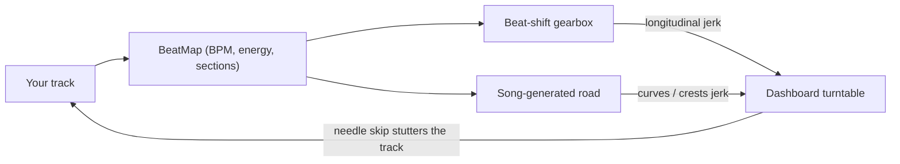

# Future Funk OutRun — Design Spec

> Gameplay source of truth. Architecture rules live in `AGENTS.md`; this file describes **what** the mechanics are and **why**.
> All numbers marked _(start)_ are initial tuning values, to be exposed in `tuning.ts` / DebugPanel.

---

## 1. Core Loop

**Load your songs → each song becomes a road → drive it in sync with the music → forks pick the next song in your playlist.**

The three new mechanics form one closed loop around the music:



---

## 2. Bring Your Own Soundtrack (Core Feature)

### 2.1 Import flow

1. Player drops files / a folder onto `TrackLoader` (or uses the file picker). Supported: whatever `decodeAudioData` handles in the browser (mp3, m4a/aac, wav, ogg, flac on Chromium/Firefox).
2. Hash file bytes (SHA-256 via `crypto.subtle`) → look up cached `BeatMap` in IndexedDB.
3. On cache miss: decode → analyse in worker → show result with confidence → player can correct (×2, ÷2, tap tempo, nudge bar phase).
4. The ordered list of tracks is the **playlist**; it becomes the run's stage sequence.

Files are re-picked each session unless the File System Access API is available (Chromium), in which case directory handles are persisted. BeatMaps are always persisted (they are tiny and contain no audio).

### 2.2 BeatMap schema

```jsonc
{
  "version": 1,
  "contentHash": "sha256:…",          // also the road seed
  "title": "…", "artist": "…",        // from filename / tags when available
  "durationSec": 214.3,
  "bpm": 118.02,                      // refined, not integer-rounded
  "firstBeatOffsetSec": 0.412,        // time of first downbeat (bar 1, beat 1)
  "beatsPerBar": 4,
  "barEnergy": [0.21, 0.24, …],       // 0..1, one per bar, smoothed
  "sections": [                       // snapped to 4-bar boundaries
    { "startBar": 0,  "bars": 16, "role": "intro" },
    { "startBar": 16, "bars": 8,  "role": "build" },
    { "startBar": 24, "bars": 16, "role": "drop" }
  ],
  "confidence": { "tempo": 0.92, "downbeat": 0.71, "tempoStable": true },
  "source": "analysis"                // "analysis" | "manual" | "bundled"
}
```

Section roles: `intro`, `build`, `drop`, `breakdown`, `outro`.

### 2.3 Analysis pipeline (`TrackAnalyzer` + `analysis.worker.ts`)

Runs once per file at import. Future funk is almost always steady-tempo 4/4 and quantized, so we optimise for that case and flag the rest.

| Step            | Method                                                                                                                                                                                                      |
| --------------- | ----------------------------------------------------------------------------------------------------------------------------------------------------------------------------------------------------------- |
| Decode          | `OfflineAudioContext` at 22 050 Hz mono → `Float32Array`, transferred to worker                                                                                                                             |
| Onset envelope  | Log-magnitude spectral flux (half-wave rectified), hop ≈ 5.8 ms; separate low-band (< 150 Hz) kick flux                                                                                                     |
| Coarse tempo    | Autocorrelation of onset envelope over 70–180 BPM with a log-Gaussian prior centred at 120 BPM; keep ×2 / ÷2 candidate scores for the confidence value                                                      |
| Grid refinement | Fit a single constant-tempo grid over the **whole track** (fine search ±0.5 BPM in 0.005 steps + phase), maximising onset alignment. Integer BPM is not enough: 0.1 BPM error drifts ~150 ms over 3 minutes |
| Tempo stability | Alignment score per 8-bar window; if it drops below threshold → `tempoStable: false`                                                                                                                        |
| Downbeat        | Among the 4 beat phases, choose the one with the strongest kick + spectral change on beat 1                                                                                                                 |
| Bar energy      | Per-bar RMS + low-band energy + spectral centroid → normalised, smoothed                                                                                                                                    |
| Sections        | Novelty curve on bar features, boundaries snapped to 4 bars; roles assigned by relative energy and slope (rising → `build`, top tier → `drop`, dip after drop → `breakdown`)                                |

Unstable-tempo tracks remain playable: the road is generated from energy only, and beat-judged mechanics (beat-shift bonus, BPM pulse) are disabled for that song with a toast.

### 2.4 M3a validation corpus & exit criteria

Local corpus in `test-tracks/` (gitignored), 15 tracks, with `test-tracks/ground-truth.json`:

```json
{
  "tracks": [
    { "file": "example.mp3", "bpm": 120, "firstDropSec": 45.2, "notes": "long beatless intro" }
  ]
}
```

`bpm` is required (from Tunebat / Beatport / tapping); `firstDropSec` and `notes` are optional.

`BeatMapInspector` (`?analyze`) analyses every file, shows detected vs ground truth, plots onset envelope / bar energy / sections, and plays the track with a **click track** on the detected grid (accent on downbeats).

**Exit criteria (all must pass):**

| Check                                                                  | Target                                                   |
| ---------------------------------------------------------------------- | -------------------------------------------------------- |
| Tempo, exact (±0.5 BPM of ground truth)                                | ≥ 12 / 15                                                |
| Tempo, exact or octave error (×2 / ÷2, one-click fixable)              | ≥ 14 / 15                                                |
| Grid drift — click still in sync in the **last 30 s** (listening test) | ≥ 12 / 15                                                |
| Downbeat correct (accent lands on "1", listening test)                 | ≥ 10 / 15 (nudge UI covers the rest)                     |
| First drop detected within ±2 bars (tracks with `firstDropSec`)        | ≥ 70 %                                                   |
| Analysis time for a 4-min track                                        | < 3 s; main thread never blocked > 100 ms besides decode |

If tempo/drift criteria fail: switch import to **tap-tempo-first** (analysis only proposes, player confirms) and simplify sections to energy-only before continuing to M4.

---

## 3. Song-Driven Road (M4)

**Hybrid generation:** a vocabulary of hand-authored `RoadChunks` (4 or 8 bars each), selected and sequenced by the BeatMap, seeded by `contentHash`. Same song → same road, always.

| Section role | Chunk pool                                                           |
| ------------ | -------------------------------------------------------------------- |
| `intro`      | Gentle straights, wide sweepers, scenery establishing                |
| `build`      | Climbs that **crest exactly on the first bar of the following drop** |
| `drop`       | Long fast straights, high-speed sweepers, traffic weaving            |
| `breakdown`  | Technical S-bends, hairpins (drift showcases), dips                  |
| `outro`      | Wind-down sweepers ending at the fork                                |

Rules:

- Chunk intensity scales with `barEnergy` (curve strength, hill amplitude, traffic density).
- Chunks are mirrored/varied with `SeededRandom` so the vocabulary does not repeat visibly.
- Segment distance per bar = `referenceSpeed × barDuration`, where `referenceSpeed` _(start: 0.85 × maxSpeed)_ is a strong-but-not-perfect pace.

**Song ↔ road sync (proposed):** the song is the master clock and never waits.

- Driving at reference pace means crests land on drops — reward with a **SYNC** Groove bonus when the player crosses a "drop marker" within ±1 beat of the drop.
- Falling behind: the song reaches its outro before the fork → the DJ loops the last 8 outro bars until the player reaches the fork.
- Running ahead: reaching the fork early starts the 4-bar crossfade early (as a DJ would).

---

## 4. Beat-Shift Gearbox (M5)

OutRun had a LOW/HIGH stick; we extend it into a rhythm mechanic without becoming a sim.

- **4 gears**, top-speed ratios _(start)_ `[0.35, 0.60, 0.82, 1.00] × maxSpeed`.
- `rpm = speed / gearTopSpeed`; fake torque curve peaks around 0.7 rpm and fades toward redline; redline is a soft limiter (speed holds, no damage). Replaces the current single `accelTaper` curve in `PlayerCar`.
- **Beat judgement** on every manual shift (timestamp-based, latency-compensated, AGENTS.md §4.8):
  - `PERFECT` ±50 ms _(start)_ of a beat, `GOOD` ±100 ms; downbeat of a bar counts as a bigger bonus.
  - Only counts when the shift makes sense (upshift at ≥ 0.75 rpm, downshift that keeps rpm < redline) → no spamming.
  - Reward: 1-beat torque boost _(start: +15 %)_, Groove gain, brief low-pass filter "blip" open.
  - Off-beat shift: works normally, no bonus, **no penalty** (Pillar 3).
- **Auto-shift assist** (option, off by default): shifts at optimal rpm, earns no beat bonus.
- Each shift produces a longitudinal jerk proportional to the rpm drop → feeds the turntable (§5).
- Engine voice: synthesized oscillator pitched by rpm, mixed well under the music (M5, low priority).

---

## 5. Dashboard Turntable & Tofu Mode (M5)

Our "Takumi's tofu": a portable turntable on the dashboard. The core lesson is **smooth inputs**, so the model reacts to **jerk** (change of acceleration), not acceleration itself.

### 5.1 Needle physics (always on)

- Inputs per step: lateral acceleration (steering + centrifugal + drift), longitudinal acceleration (throttle, brake, shifts, collisions), vertical (slope change at crests/dips). Differentiate → jerk `j`.
- Needle = spring-damper: `θ'' = −k·θ − c·θ' + G·j` _(start: tune so a clean committed drift entry never skips; jerky counter-steering and panic braking do)_.
- `|θ| > skipThreshold` → **needle skip**: grid-preserving audio stutter (beat-repeat of the last 1/16 beat ×2–3 while the real source keeps running muted underneath, plus a vinyl tick). The beat grid and road sync are never displaced.
- Outside Tofu Mode a skip is **feedback only**: no Groove loss. It teaches smoothness through the ears.

### 5.2 Tofu Mode (toggle)

- Button toggles Tofu Mode; the change applies at the next 4-bar boundary (no dodging a hairpin at the last second).
- While active: turntable inset visible (≈ 120×80 px, bottom-left, drawn on canvas by the engine), **Groove gain ×2** _(start)_, each skip costs Groove _(start: −10 % of current tier progress)_.
- Turning it off ends the multiplier streak. Never a fail state.

### 5.3 Cosmetics

The turntable is the default; a melon cream-soda glass (liquid level/spill instead of needle) is a later unlockable skin using the same physics.

---

## 6. Controls

| Action             | Keyboard      | Gamepad (M8)       |
| ------------------ | ------------- | ------------------ |
| Steer              | ← → / A D     | Left stick / D-pad |
| Accelerate / Brake | ↑ ↓ / W S     | RT / LT            |
| Drift              | Space / Shift | A / Cross          |
| Shift up / down    | E / Q         | RB / LB            |
| Tofu Mode          | T             | Y / Triangle       |

Shift and Tofu Mode need **press edges with timestamps** in `InputManager` (polling `isDown` alone is not enough for beat judgement).

---

## 7. Open Questions

- `referenceSpeed` value and whether it adapts to the player's Groove tier.
- Drift exit boost was removed in M2; revisit once beat-shift boosts exist to avoid overlapping rewards.
- Mix level of engine voice vs. user music (default probably off for user tracks).
- How to present `tempoStable: false` songs (allowed with reduced features, or warned at import).
