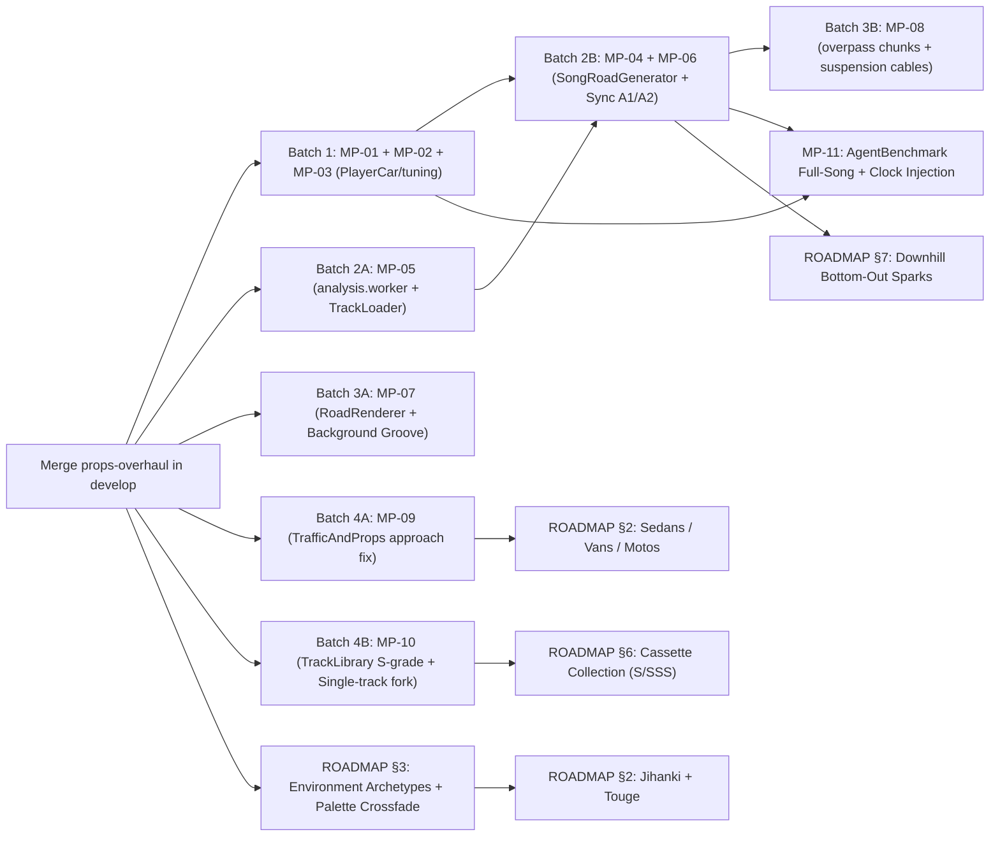

# 真夜中Cassette (Mayonaka Cassette) — Audit Critico di Game Design & Specifiche di Orchestrazione

> **Destinatario:** Agente di orchestrazione futuro incaricato di pianificare, scomporre in batch e far implementare il polish delle meccaniche di gameplay, del road generator e dei dettagli aperti di roadmap.
>
> **Regola d'uso:** Ogni Work Package (`MP-01` .. `MP-12`) contiene evidenze empiriche riproducibili, root cause esatta su codice verificato, vincoli architetturali non negoziabili (`AGENTS.md`, `docs/DESIGN.md`) e criteri di accettazione misurabili.

---

## 1. Baseline Verificata & Riconciliazione Repository

- **Baseline Audit & Playtest Completo:** eseguito allo snapshot `67c2516` (`2026-11-12`):
  - Check statico/suite (`npm run check`, `2026-11-12`): exit `0` (`eslint .`, `vitest run` — 33 file / 198 test passati, `tsc --noEmit`, `vite build`).
  - Gate analisi M3a (`TrackAnalyzer.test.ts`, corpus `test-tracks/`): `Exact BPM = 15/15`, `Exact/Octave = 15/15`, `DriftFree = 15/15`, `Downbeat = 13/15`, `FirstDrop = 13/15 (87%)`, `MaxTime = 2256ms`. I 2 drop mancati sono `Call_Stack.mp3` (Δ 8.01 battute) e `Selfish_High_Heels...` (Δ 12.13 battute).
  - Playtest headless full-song e micro-probe fisici (`AutopilotDriver` + `Game`, `2026-11-12`) sulle tracce bundled e sul corpus reale.
- **Stato Repository Riconciliato (`2026-11-15`):**
  - Branch corrente: `props-overhaul` @ commit `150037a` (+ WIP locale su `docs/`, `src/road/`, `.github/`).
  - Branch `develop` e `main`: fermi a `c8cbdb8`.

### 1.1 Stato Riconciliato tra `2026-11-12` e `2026-11-15` (`props-overhaul`)

Per evitare lavoro duplicato o conflitti di contesto, l'orchestratore deve considerare la seguente separazione tra ciò che è già stato affrontato su `props-overhaul` e ciò che rimane effettivamente aperto:

| Area | Stato al `2026-11-15` | Dettaglio verificato | Azione per Orchestratore |
| :--- | :--- | :--- | :--- |
| **Piloni & cavi elettrici (`pylon`)** | **Implementato su `props-overhaul`** | `src/road/SceneryCorridors.ts` + wiring cavi in `src/road/RoadRenderer.ts` (`L77`, `L270-272`) | **NON reimplementare** |
| **Skyline `Sunset Boulevard` che copriva il tramonto** | **Risolto su `props-overhaul`** | Fix `computeCoastalTowerHeight` in `src/engine/Background.ts` (commit `1c7faee`) | **NON reimplementare** |
| **Vignette composite a bordo strada** | **Implementato su `props-overhaul`** | `src/road/Vignettes.ts` (`bus-stop`, `parking-area`, `shrine-gate`, `jihanki-corner`) integrate in `RoadChunks.ts` | **NON reimplementare** |
| **Taglio ponti sospesi da A2 Horizon Stitch** | **Risolto su `props-overhaul`** | Guardia `env === 'bridge'` su finestra visibile in `src/engine/SongRoadSyncController.ts` (`L155-166`) | **NON reimplementare** |
| **Cassette Deck preview & beat calibration** | **Implementato su `props-overhaul`** | Preview playback e calibrazione beat in `src/ui/TrackLoader.tsx` e `src/ui/TrackLoader.test.ts` (commit `503d39d`) | **NON reimplementare** |
| **Distributori `jihanki` a bordo strada** | **Intenzionalmente in pausa** | `docs/ROADMAP.md §2`: sospeso finché non esistono gli **Environment Archetypes** (`docs/DESIGN.md §3.1`, `ROADMAP.md §3`). `jihanki-corner` in `Vignettes.ts` attualmente non spawna `jihanki` | Pianificare **solo dopo** i Biomi/Archetipi (`§3`) |
| **Core Gameplay, Sync, Groove World Glow, `overpass`, Catenarie, Traffico, Scoring** | **TUTTI APERTI** | `PlayerCar`, `Gearbox`, `MelonSoda`, `TrackLibrary`, `StageForkController`, `DriverManualModal`, `analysis.worker`, elevation closure, `overpass`, cavi `suspension-tower` e world Groove glow invariati | **Oggetto dei Work Package `MP-01` .. `MP-12`** |

### 1.2 Prerequisito Git & Branching (`AGENTS.md §2, §4.10`)

1. Prima di aprire branch dedicati a `Batch 1`–`Batch 5`, assicurarsi che `props-overhaul` sia stabilizzato e integrato in `develop` (oggi a `c8cbdb8`).
2. Tutti i nuovi branch devono staccarsi da **`develop`** e rientrare su **`develop`** (mai committare o pushare direttamente su `main`).
3. **Un branch coeso per batch di meccaniche interdipendenti**, in modo da testare e bilanciare il sistema unitario prima del merge.

---

## 2. Invarianti Architetturali Non Negoziabili (`AGENTS.md` & `docs/DESIGN.md`)

L'agente di orchestrazione deve inserire esplicitamente questi vincoli in ogni brief ai worker:

1. **Zero React nel Core TS (`@src/config`, `@src/core`, `@src/engine`, `@src/road`, `@src/audio`, `@src/entities`):** vietato importare React (enforced via ESLint `no-restricted-imports`).
2. **Feel Over Simulation (`AGENTS.md §1.1`):** vietato introdurre motori rigid-body; tutta la fisica usa formule arcade parametriche in `src/config/tuning.ts`.
3. **Protect the Flow State (`AGENTS.md §1.3`):** nessun dead stop, nessuna esplosione o game-over improvviso; i cambi marcia fuori tempo non vanno mai puniti (semplicemente nessun bonus).
4. **Beat-Shift Speed Boost Vietato (`docs/DESIGN.md §4`):** i cambi marcia a tempo non devono dare burst artificiali di velocità — il premio è Groove, filtro audio, scoring e feedback di guida. *(Nota: questo non vieta il recupero/slancio post-drift pulito trattato in `MP-02`, che appartiene alla fisica del drift.)*
5. **Fixed-Timestep & Zero GC (`AGENTS.md §4.2, §4.3`):** `SIM_STEP = 1/120` s, `MAX_FRAME_DT = 0.1` s; **nessuna allocazione** di oggetti, array o closure dentro `render()` e `project()`.
6. **Deterministic Song Roads (`AGENTS.md §4.6`):** `SongRoadGenerator` è funzione pura di `(BeatMap, seed)` usando solo `SeededRandom` (mai `Math.random()`). Lunghezza strada in battute = lunghezza brano in battute.
7. **Beat Judgement da Event Timestamp (`AGENTS.md §4.8`):** in runtime reale i cambi marcia si giudicano da `event.timeStamp` mappato sull'orologio audio (`FunkAudioEngine.judgeInputTimestamp`), mai dal frame rate o dal tick fisso; l'analisi DSP resta confinata a import-time in `analysis.worker.ts`.
8. **Canvas-Owned Animated Insets (`AGENTS.md §4.9`):** tutto ciò che anima ogni frame (Melon Soda, eventuali gocce sul parabrezza) è renderizzato dal canvas engine, non da React.

---

## 3. Sintesi Critica di Game Design (I 7 Assi dell'Audit)

Prima dei ticket atomici, ecco il quadro diagnostico complessivo emerso dall'esame critico e dai playtest:

1. **Il vibe è trasmesso bene, ma il payoff mondiale in `OVERDRIVE` è assente:** plancia VFD, cassetta HUD, Honda City + Motocompo, Kei Truck, cavi elettrici e skyline `Sunset Boulevard` costruiscono un'identità forte; tuttavia né `RoadRenderer` né `Background` leggono mai lo stato di Groove, contraddicendo il manuale utente che promette *"road glow"* ai tier superiori (`MP-07`).
2. **Elementi frustranti identificati:**
   - **Auto-drain in 6ª marcia in `OVERDRIVE` (`MP-01`):** guidare puliti al 100% su rettilineo consuma `-1.6/s` di Groove in `OVERDRIVE`, punendo proprio chi mantiene il flow pulito.
   - **Precipizio/rampa verticale di chiusura negli ultimi 4 bar (`MP-04`):** dislivelli accumulati fino a `-73,027` o `+47,006` unità mondo che vengono azzerati brutalmente sull'ultimo segmento.
   - **Mancati Drop Sync ad alta velocità / dopo molti drift (`MP-06`):** in modalità `perfect + Tofu` l'auto arriva fuori dalla finestra `±1.25` battute (`0/3` drop su `Stellae` contro `3/3` in `relaxed`).
   - **Nessun traguardo in Single-Track (`MP-10`):** chi importa un solo brano gira in loop infinito senza ricevere una chiusura né una Grade Screen se non uscendo manualmente.
3. **Coerenza Filosofia vs Implementazione:** il principio *"Music Drives State, Driving Manipulates Music"* funziona bene su filtro/beat-pulse/Tofu Mode, ma zoppica su tre punti: (a) il **straight-road drift exploit** premia il serpeggiare a bassa velocità su rettilineo più della guida veloce (`MP-02`), (b) l'**exit boost da drift** promesso dal `DriverManualModal` non esiste (`MP-02`), (c) il **latch `S+Steer`** resta attivo senza tasti tenuti premuti e `[LCTRL]` è invisibile nel manuale (`MP-03`).
4. **Grafica piacevole ma con due gap di finitura:** i prop di `RoadsideProps` sono curati (con `pylon` e `Sunset Boulevard` già fixati su `props-overhaul`), ma `overpass` (`Ponte A`, 3 varianti già disegnate e testate) non viene mai spawnato da alcun chunk, e `drawSuspensionTower` disegna cavi catenari mozzati a due rettangoli verticali (`MP-08`).
5. **Drift & Groove Meter:** oggi il Drift + Groove formano un loop distorto (troppa resa su rettilineo, drenaggio forzato in `OVERDRIVE`, nessuna risposta fisica all'uscita dal drift). Sistemati `MP-01`, `MP-02`, `MP-03` e `MP-07`, il ciclo rischio/ricompensa torna leggibile e gratificante.
6. **Qualità dei Chunk:** alcuni chunk funzionano bene (curve veloci e salite), ma su brani lunghi (80–120+ bar) la varietà visibile scende (`9/17` chunk unici su `Yung Bae`, `14/21` su `Stellae`), manca il vero passaggio sotto `overpass` e la gestione dell'elevazione è priva di bilancio verticale (`MP-04`, `MP-06`, `MP-08`).
7. **Costruzione Dinamica (`il Cuore del Gioco`):** l'architettura `(BeatMap, seed) -> SongRoadGenerator -> A1/A2 Sync` è solida nel concetto ma indebolita da tre anelli: (i) la quantizzazione rigida a 4 battute collassa interi brani in `drop` monolitici da 56–72 battute (`MP-05`), (ii) i `FirstDrop` miss sul corpus M3a (`2/15`, `13%` mancati su `Call_Stack.mp3` e `Selfish_High_Heels`) (`MP-05`), (iii) la mancata compensazione di quota (`MP-04`) e l'assenza di adattamento di `referenceSpeedRatio` al `grooveTier` (`MP-06`).

---

## 4. Catalogo Work Package (Raggruppati in Batch)

---

### BATCH 1 (`P0`) — Core Driving Feel, Drift Physics & Groove Economy
> **Branch suggerito:** `feat/drift-groove-feel` (staccato da `develop`).  
> **Nota orchestratore:** `MP-01`, `MP-02` e `MP-03` modificano tutti `src/entities/PlayerCar.ts` e `src/config/tuning.ts` — devono essere eseguiti sequenzialmente su un unico branch o da un solo worker owner.

#### `MP-01` — Sostenibilità di `OVERDRIVE` in 6ª Marcia su Rettilineo (Auto-Drain)
- **Priorità:** `P0`
- **Sintomo & Evidenza Empirica:**
  - Micro-probe 3C (`100%` speed, 6ª marcia, `curve = 0`, Groove iniziale `95% OVERDRIVE`):
    - `5s: 87.0% (OVERDRIVE) -> 10s: 79.0% (HIGH) -> 15s: 83.9% (OVERDRIVE) -> 20s: 81.6% (HIGH)`.
  - Anche con guida perfettamente pulita alla massima velocità su rettilineo, il giocatore viene espulso da `OVERDRIVE` ogni ~10 secondi.
- **Root Cause:**
  - In `src/config/tuning.ts` (`L73`, `L76-77`) e `src/entities/PlayerCar.ts` (`L604`, `L614`):
    - `grooveCruiseGainRate = 2.4`
    - `grooveOverdriveCruiseScale = 0.5`
    - `grooveOverdriveDrainRate = 2.8`
  - Il guadagno massimo di crociera in `OVERDRIVE` è `2.4 * 0.5 = 1.2/s` contro un drain di `2.8/s` -> **deficit netto fisso di `-1.6/s`**.
- **Direzione Tecnica & Vincoli:**
  - Permettere di **sostenere** (o decadere quasi a zero solo sotto soglia velocità) `OVERDRIVE` quando l'auto viaggia pulita ad alta velocità (`>= ~85-90%` max speed o in 5ª–6ª marcia su asfalto), lasciando invece il drain significativo quando il giocatore rallenta, esce fuori strada (`grooveOffRoadDrainRate`), o collide (`grooveCollisionPenalty`).
  - Preservare l'isteresi dei 4 tier (`LOW`, `MEDIUM`, `HIGH`, `OVERDRIVE`) definita in `AGENTS.md §5 M5`.
- **File Target:** `src/config/tuning.ts`, `src/entities/PlayerCar.ts`.
- **Dipendenze:** si bilancia insieme a `MP-02`.
- **Criteri di Accettazione:**
  - Test unitario/simulazione su rettilineo al `95-100%` velocità in 6ª marcia per 20s partendo da `95% OVERDRIVE`: il Groove non deve scendere sotto la soglia di `OVERDRIVE` in assenza di errori/rallentamenti.
  - A bassa velocità (`< 65%` senza drift o shift a tempo), `OVERDRIVE` deve invece scaricarsi verso `HIGH` entro pochi secondi.

#### `MP-02` — Exploit Drift su Rettilineo & Drift Exit Boost vs `DriverManualModal`
- **Priorità:** `P0`
- **Sintomo & Evidenza Empirica:**
  - Micro-probe 3B (`5s` su rettilineo `curve = 0`, Groove iniziale `20%`):
    - Crociera pulita: `endGroove = 30.6%` (`speed = 0.95`).
    - Farming drift su rettilineo: `endGroove = 59.9%` (`speed = 0.49`, `offRoad = false`, `carX = 0.01`).
    - Derapare a metà velocità su un rettilineo rende quasi **4×** rispetto a guidare veloci e puliti (`+39.9%` vs `+10.6%`).
  - Micro-probe 3E (uscita da drift di `1.0s`):
    - Velocità prima del rilascio: `7610.61` -> 1 tick dopo l'uscita: `7577.81` (`delta = -32.80`).
    - Tuttavia `src/ui/DriverManualModal.tsx:175` recita: *"Straighten out cleanly after 0.6s+ of slide for a forward momentum kick."* e `src/entities/Particles.ts` contiene `emitBoostOrShiftBurst` con il commento `(exhaust flames removed)`.
- **Root Cause:**
  - `src/entities/PlayerCar.ts` applica `grooveDriftGainRate = 12.0` (`src/config/tuning.ts:74`) senza pesarlo sull'effettiva curvatura del segmento (`segmentCurve`) né sull'angolo/carico reale in curva.
  - `src/config/tuning.ts` (`L34-40`) e `PlayerCar.ts` non implementano alcun boost/recupero di slancio in uscita dal drift.
- **Direzione Tecnica & Vincoli:**
  1. **Anti-Exploit Rettilineo:** scalare il tasso di Groove guadagnato in drift in funzione di `Math.abs(segmentCurve)` (es. `0` o frazione trascurabile per `|curve| < 0.35`, crescita lineare fino a `1.0x` su curve reali, opzionale micro-bonus per vicinanza al cordolo/apex).
  2. **Clean Exit Boost (consigliato rispetto a tagliare il testo):** implementare una breve fase di recupero spinta/coppia (es. `0.35-0.6s`) al riallineamento pulito dopo un drift effettivo in curva di almeno `0.6s` (`tuning.driftMinBoostTime` / `tuning.driftExitBoostAccel` ecc.), coerente con `DriverManualModal.tsx:175` e con i spark già presenti in `Particles.ts` (`driftTime >= 0.75 || grooveTier === 'OVERDRIVE'`), riabilitando un feedback visivo/particellare pulito sull'uscita.
  3. *(Vincolo `docs/DESIGN.md §4`: verificare che eventuali scie/particelle in `emitBoostOrShiftBurst` non creino confusioni con il divieto di boost da cambio marcia.)*
- **File Target:** `src/entities/PlayerCar.ts`, `src/config/tuning.ts`, `src/entities/Particles.ts`, `src/ui/DriverManualModal.tsx` (allineare testo esatto a soglia/comportamento finale).
- **Dipendenze:** da progettare coerentemente con `MP-01` e `MP-03`.
- **Criteri di Accettazione:**
  - Su `curve = 0` per `5s`, drifare non deve superare il guadagno Groove di una guida veloce al `95%` di velocità.
  - Dopo un drift in curva reale (`|curve| >= 1.5`) di `>= 0.6s`, raddrizzare l'auto senza urti/off-road produce un incremento misurabile di `speed` (`delta > 0`) entro i primi `0.3-0.5s` dal rilascio.

#### `MP-03` — Rimozione Latch Automatico `S+Steer`, Separazione Frenata & Documentazione `[LCTRL]`
- **Priorità:** `P0`
- **Sintomo & Evidenza Empirica:**
  - Micro-probe 3A: partendo da `speed = 9500.0`, dopo 1 solo frame di `S + D` la velocità crolla subito a `9400.0` (`delta = -100.0`) con `driftOnTap = true`; rilasciando **tutti i tasti**, dopo `0.5s` in una curva `1.5` l'auto è ancora bloccata in drift (`stillDriftingAfter0.5sWithNoInputIn1.5Curve = true`).
  - `src/core/InputManager.ts:44` definisce `ControlLeft: 'drift'`, ma `src/ui/DriverManualModal.tsx:163,229` mostra solo `[S] / [DOWN]` omettendo `[LCTRL]`.
- **Root Cause:**
  - `src/entities/PlayerCar.ts` (`L530, L535, L539, L555`):
    - `this.brakeDriftActive = !controls.drift && brakeJustPressed;`
    - `canSustain = this.brakeDriftActive` resta `true` finché `aboveMinSpeed && (rawSteer !== 0 || Math.abs(segmentCurve) > 1.2)` — ossia nessuna pressione continua è richiesta finché la strada curva.
    - Contestualmente `controls.brake` applica la decel da freno sul frame di pressione, penalizzando subito la velocità.
- **Direzione Tecnica & Vincoli:**
  - Il giocatore deve controllare intenzionalmente ingresso e uscita del drift:
    - Tasto dedicato `[LCTRL]` (drift puro senza frenata punitiva al primo frame) -> attivo finché tenuto premuto (`controls.drift`) sopra `driftMinSpeedRatio`.
    - Eventuale trigger tramite `[S]/[DOWN]` in ingresso curva -> solo finché `[S]/[DOWN]` o controsterzo attivo resta tenuto (o timer di grace brevissimo tipo `<= 120ms` per transizioni tastiera), **mai** latch infinito automatico basato sulla sola curvatura della strada senza input giocatore.
  - Aggiornare `DriverManualModal.tsx` (`L163`, `L229` e sezione controlli) per esporre esplicitamente `[LCTRL]` come tasto Drift dedicato e `[S]/[DOWN]` come Freno (+ drift assistito se mantenuto).
  - Verificare `AutopilotDriver.ts` affinché continui a guidare/derapare in modo pulito con il nuovo contratto di input.
- **File Target:** `src/entities/PlayerCar.ts`, `src/ui/DriverManualModal.tsx`, `src/core/AutopilotDriver.ts`.
- **Dipendenze:** condivide `PlayerCar.ts` con `MP-01` e `MP-02`.
- **Criteri di Accettazione:**
  - Rilasciando tutti i tasti dopo un tap di `S+D` in una curva `1.5`, l'auto esce dal drift entro `<= 0.15s` invece di restare agganciata per `0.5s+`.
  - Tenendo `[LCTRL]` + sterzo in curva si entra in drift senza il drop brusco di frenata piena del freno puro.
  - `DriverManualModal.tsx` documenta `[LCTRL]` in modo coerente con `InputManager.ts:44`.

---

### BATCH 2 (`P0/P1`) — Integrità Strada Dinamica, Analisi & Sincronia Spaziotemporale
> **Branch suggerito:** `feat/song-road-sync-polish` (staccato da `develop`).  
> **Nota orchestratore:** `MP-04` e `MP-06` convergono su `SongRoadGenerator.ts` e `RoadChunks.ts`; `MP-05` lavora primariamente in `analysis.worker.ts` / `TrackLoader.tsx` ma influenza il `BeatMap` letto da `MP-04` e `MP-06`.

#### `MP-04` — Chiusura Altimetrica (`Elevation Drift`) & Rimozione Precipizio Finale
- **Priorità:** `P0`
- **Sintomo & Evidenza Empirica:**
  - Audit dinamico della strada generata (playtest & analisi strutturale `2026-11-12`, `@ 67c2516`):
    - `Sailor Bae` (`76 bar`): `minY = -67512`, `maxY = 1576`, `maxStep = 601`, salto nell'ultimo blocco: `yBeforeLast4Bars = -67334 -> 0`.
    - `Yung Bae Lonely Feeling Edit Future Funk` (`88 bar`): `minY = -73027`, `maxY = 15799`, `maxStep = 574`, salto finale `-73027 -> 0`.
    - `soda city funk` (`80 bar`): `minY = -8084`, `maxY = 47006`, `maxStep = 362`, salto finale `42445 -> 0`.
- **Root Cause:**
  - `src/road/SongRoadGenerator.ts` (`L211-212`, `L218`): ogni manovra somma `endY = startY + m.elevation * hillScale * segmentLength` senza bilancio cumulativo né bias compensativo; poi **esclusivamente sull'ultima manovra dell'ultimo chunk** (`if (isFinalChunkOfTrack && isLastManeuverInChunk) { endY = 0; }`) forza `endY = 0`. Il risultato è una parete verticale / abisso anomalo a fine brano, che compromette anche l'occlusione Pseudo-3D e rende visivamente innaturale il bivio finale.
- **Direzione Tecnica & Vincoli:**
  1. Introdurre **soft elevation bounding + bias compensativo** nella selezione dei chunk di `SongRoadGenerator.ts` (se la quota accumulata si discosta troppo da `0`, favorire chunk con ΔY di segno opposto compatibili col ruolo musicale).
  2. Applicare un **ritorno progressivo verso `y = 0`** distribuito sull'intera coda `outro` / pre-fork (es. ultimi `4-8` bar con ramp morbido limitato a `maxStep` guidabile, anziché una singola manovra terminale).
  3. Mantenere il determinismo puro di `(BeatMap, seed)` (`AGENTS.md §4.6`).
- **File Target:** `src/road/SongRoadGenerator.ts`, `src/road/RoadChunks.ts` (annotare/equilibrare ΔY netto dei chunk se necessario), test unitari su `SongRoadGenerator.test.ts` (o nuovo test su tutto il range di tracce).
- **Dipendenze:** nessuna bloccante; prerequisito utile prima del dettaglio scintille discesa (`ROADMAP §7`) e dell'armonizzazione ponti/bivi.
- **Criteri di Accettazione:**
  - Su tracce multi-brano da `40` a `130` bar con elevation bias positivo o negativo, nessuna singola manovra di chiusura deve avere una pendenza verticale anomala rispetto ai chunk normali, `endY` finale deve convergere esattamente a `0` lungo almeno gli ultimi `4` bar, e `|minY|`/`|maxY|` devono rimanere entro un corridoio ragionevole (es. riduzione drastica rispetto ai `±73,000` attuali).

#### `MP-05` — Over-Collapse della Segmentazione a 4 Bar, Miss M3a (`FirstDrop`) & UX `tempoStable: false`
- **Priorità:** `P1`
- **Sintomo & Evidenza Empirica:**
  - Su brani reali del corpus (audit `2026-11-12`, `@ 67c2516`), la struttura generata collassa in blocchi enormi e poco dinamici:
    - `Sailor Bae` (`76 bar`): `sections = 4 [intro(0..4), drop(4..60), breakdown(60..68), outro(68..76)]` -> **56 battute continue** di `drop`.
    - `Yung Bae` (`88 bar`): `sections = 4 [intro(0..4), build(4..8), drop(8..80), outro(80..88)]` -> **72 battute continue** di `drop`.
  - Corpus M3a (`2026-11-12`): `Downbeat = 13/15`, `FirstDrop = 13/15 (87%)`, `MaxTime = 2256ms`. I due brani falliti sul `FirstDrop` sono `Call_Stack.mp3` (Δ 8.01 bar) e `Selfish_High_Heels...` (Δ 12.13 bar).
  - Open Question ancora aperta in `docs/DESIGN.md §7`: cosa mostrare all'utente quando l'analisi rileva `tempoStable: false`.
- **Root Cause:**
  - `src/audio/analysis.worker.ts` (`L988-1033`): snapping rigido alla griglia da 4 bar e merge troppo permissivi in `blockRoles` appiattiscono le transizioni energetiche intermedie (strofe, mini-break, post-chorus, build secondari) all'interno di un singolo blocco `drop`.
  - In `src/ui/TrackLoader.tsx` manca una segnalazione guidata chiara per i file `tempoStable === false`.
- **Direzione Tecnica & Vincoli:**
  1. Affinare la sensibilità relativa della classificazione `blockRoles` / sotto-contrasti energetici in `analysis.worker.ts` (o introdurre sotto-fasi `cruise`/`build` dentro lunghi plateau di energia) mantenendo il budget di latenza `MaxTime <= 3000ms` e senza regredire sui `15/15` BPM/DriftFree.
  2. Analizzare in `TrackAnalyzer.test.ts` i profili onset/RMS di `Call_Stack.mp3` e `Selfish_High_Heels` per migliorare l'identificazione del `FirstDrop` (obiettivo `>= 14/15` o `15/15` sul corpus senza peggiorare gli altri 13 brani).
  3. Definire la UX non bloccante per `tempoStable: false` in `TrackLoader.tsx` (badge informativo + invito immediato a tap-tempo / nudge BPM o avviso che i cambi marcia a tempo potrebbero slittare su quel brano).
- **File Target:** `src/audio/analysis.worker.ts`, `src/audio/TrackAnalyzer.test.ts`, `src/ui/TrackLoader.tsx`, eventualmente `src/audio/BeatMap.ts`.
- **Dipendenze:** nessuna tecnica; eventuali modifiche allo schema `BeatMap` vanno coordinate con `SongRoadGenerator.ts` (`MP-04`/`MP-06`).
- **Criteri di Accettazione:**
  - `npm test` su `TrackAnalyzer.test.ts` mantiene `Exact BPM >= 15/15`, `DriftFree >= 15/15`, `MaxTime <= 3000ms` migliorando `FirstDrop` rispetto a `13/15`.
  - Su `Sailor Bae` e `Yung Bae`, nessun singolo blocco `drop` copre indistintamente `> 32` battute senza articolazioni o sotto-variazioni.
  - Un file con `tempoStable: false` mostra un indicatore esplicito e actionable in `TrackLoader.tsx`.

#### `MP-06` — Convergenza A1/A2 sui Drop, `referenceSpeedRatio` Adattivo al Groove & Varietà Chunk
- **Priorità:** `P1`
- **Sintomo & Evidenza Empirica:**
  - Playtest full-song (simulazione `AutopilotDriver`, `2026-11-12`, `@ 67c2516`):
    - `Stellae` [perfect, tofu=true, auto=false] (`230s`): `avgSpd = 74%`, `minSpd = 33%`, `drift = 32%`, `A1 = 0.84..1.26`, `A2 stitches = 3 (skipped 5 bars)`, **`drops = 0/3`**.
    - `Stellae` [relaxed, tofu=false, auto=true] (`230s`): `avgSpd = 70%`, `drift = 7%`, `A1 = 1.00..1.26`, `A2 stitches = 1 (skipped 1 bar)`, **`drops = 3/3`**.
    - `soda city funk` [perfect, tofu=true] (`163s`): `drift = 32%`, **`drops = 2/5`** vs [relaxed]: `drift = 9%`, **`drops = 4/5`**.
  - Bassa varietà su brani lunghi: `Stellae` (`117 bar`) usa `14/21` chunk unici; `Yung Bae` usa solo `9/17` chunk unici.
- **Root Cause:**
  - `src/engine/SongRoadSyncController.ts` (`L74`, `L97-108`, `L179`, `L218-228`) + `src/config/tuning.ts` (`L54-60`):
    - `beatsRemaining > 0.4` (`L74`) disattiva la convergenza verso il drop negli ultimi `0.4` battiti.
    - Quando il giocatore guida molto veloce (`~100%` rispetto a `referenceSpeedRatio = 0.76`) oppure recupera/perde tempo con `32%` di drift, `syncMaxSlowdown = 0.16` non basta a trattenere l'arrivo anticipato (`0.84 * 1.0 = 0.84 > 0.76`) e i lag da drift superano `syncHorizonStitchBars = 1.75` scatenando stitch A2.
    - In `checkDropSync` (`L221-226`), varcare `dm.worldZ` fuori da `|deltaBeats| <= 1.25` aggiunge subito `dm.barIndex` a `crossedDropBars`, bruciando il Drop Sync senza recupero o feedback.
    - Open Question aperta in `docs/DESIGN.md §7`: adattamento dinamico di `referenceSpeedRatio` in base al `grooveTier`.
  - `RoadChunks.ts` / `SongRoadGenerator.ts`: il pool di chunk per alcuni ruoli e la logica di selezione permettono alta ripetizione su tracce da `80-120` battute.
- **Direzione Tecnica & Vincoli:**
  1. Adattare il pacing di `SongRoadSyncController` / `referenceSpeedRatio` in modo coerente con `grooveTier` (se chi è in `OVERDRIVE` va naturalmente più forte, il pacing elastico o l'ampiezza dell'ancora deve assorbirlo senza far mancare il drop — preservando l'invariante `lunghezza strada = lunghezza canzone` su tempo nominale).
  2. Rivedere il cutoff `beatsRemaining <= 0.4` (`SongRoadSyncController.ts:74`) e la banda di slow-down/speed-up attorno ai drop imminenti, oltre a valutare se segnalare almeno un "NEAR DROP" o rendere più affidabile l'aggancio A1 dentro i `32` beat precedenti al drop (riducendo anche stitch A2 spuri durante derapate prolungate, coordinato con `MP-02`/`MP-03`).
  3. Ampliare la libreria in `RoadChunks.ts` (in coordinamento con `overpass` in `MP-08`) e aggiungere una finestra anti-ripetizione recente in `SongRoadGenerator.ts`.
- **File Target:** `src/engine/SongRoadSyncController.ts`, `src/road/SongRoadGenerator.ts`, `src/road/RoadChunks.ts`, `src/config/tuning.ts`.
- **Dipendenze:** beneficia della riduzione dei drift spuri in `MP-02`/`MP-03` e si coordina su `RoadChunks.ts` con `MP-04` e `MP-08`.
- **Criteri di Accettazione:**
  - Nei playtest full-song in modalità `perfect` + `Tofu` su `Stellae` e `soda city funk`, i `Drop Sync` agganciati devono salire drasticamente (obiettivo >= `80%`, eliminando lo `0/3` su `Stellae`) e gli stitch A2 ridursi in assenza di arresti prolungati.
  - Nessun chunk identico selezionato consecutivamente (salvo fallback forzato da lunghezza residua), e incremento del rapporto chunk unici su `Stellae` e `Yung Bae`.

---

### BATCH 3 (`P1`) — Payoff Audiovisivo del Mondo & Landmark Stradali
> **Branch suggerito:** `feat/world-groove-landmarks` (staccato da `develop`).  
> **Nota orchestratore:** `MP-07` (`RoadRenderer`, `Background`, `Game`) e `MP-08` (`RoadsideProps`, `RoadChunks`) sono quasi del tutto indipendenti tra loro, salvo eventuali tocchi minimi su `RoadRenderer.ts`.

#### `MP-07` — Collegamento Reattivo di `Groove / OVERDRIVE` a Strada e Cielo
- **Priorità:** `P1`
- **Sintomo & Evidenza Empirica:**
  - `git grep -n "grooveTier\|groove" src/road/ src/engine/Background.ts` restituisce **0 occorrenze**.
  - `src/ui/DriverManualModal.tsx:141-142` promette al giocatore: *"Higher tiers unlock full synthwave frequencies and road glow"*, ma oggi al crescere del Groove si apre solo il filtro audio e cambia la grafica HUD: asfalto, linee di corsia, cordoli e cielo restano identici tra `LOW` e `OVERDRIVE`.
- **Root Cause:**
  - `Game.ts` passa `beatPulse` a `RoadRenderer` e `Background`, ma non inoltra né `groove` (`0..100`) né `grooveTier`.
- **Direzione Tecnica & Vincoli:**
  - Aggiungere un parametro primitivo/numerico (es. `grooveIntensity: number` o `grooveTierIndex: 0..3`, **zero oggetti allocati nel loop di render**, rispettando `AGENTS.md §4.3`) alle chiamate di rendering di `RoadRenderer` e `Background`:
    - `LOW`: mondo più scuro/attenuato, strisce e riflessi sobri.
    - `HIGH` -> `OVERDRIVE`: incremento di luminescenza/glow sulle linee laterali e di mezzeria, maggiore enfasi del `beatPulse` su cordoli/orizzonte/griglia synthwave/bagliore atmosferico (coerente con tutte e 4 le palette in `src/road/palette.ts`).
- **File Target:** `src/engine/Game.ts`, `src/road/RoadRenderer.ts`, `src/engine/Background.ts`, `src/road/palette.ts`.
- **Dipendenze:** indipendente da `MP-01`..`MP-06` (reagisce a qualsiasi valore di Groove/Tier emesso dal motore).
- **Criteri di Accettazione:**
  - Verifica visiva / test di render `RoadRenderer.test.ts` e `Background` che dimostri differenza cromatica/luma misurabile tra stato `LOW` e stato `OVERDRIVE` a parità di posizione e `beatPulse`.
  - Zero allocazioni aggiuntive per frame in `render()`/`project()`.

#### `MP-08` — Attivazione Chunk per `overpass` (Ponte A) & Completamento Cavi `suspension-tower`
- **Priorità:** `P1`
- **Sintomo & Evidenza Empirica:**
  - `src/road/RoadsideProps.ts:1239` implementa `drawOverpass` (con 3 varianti complete verificate in `src/road/RoadsideProps.test.ts:250-269`: Shuto Expressway concrete, steel truss girder, variante 2) e `src/road/RoadChunks.ts:254` si chiama `'build-overpass-spiral-8'`, ma **nessun chunk né regola spawner istanzia mai `{ kind: 'overpass' }`** (`git grep` su `src/road/` conferma zero spawn!).
  - `src/road/RoadsideProps.ts:1426,1511-1514` (`drawSuspensionTower`): sotto il commento `// Main catenary cables`, disegna soltanto due tronconi verticali (`ctx.fillRect(leftX, topY, cableThick, Math.round(towerH * 0.3))` e corrispettivo destro), senza alcuna parabola o cavo di campata.
- **Root Cause:**
  - `overpass` aggiunto al renderer e ai test ma scollegato dal catalogo chunk.
  - `drawSuspensionTower` rimasto con stub geometrico dei cavi.
- **Direzione Tecnica & Vincoli:**
  1. Cablare `{ kind: 'overpass' }` dentro `build-overpass-spiral-8` (`RoadChunks.ts:254`) e/o nuovi chunk dedicati (verificando corretta z-order/ombra in `RoadRenderer.ts:286` e clearance verticale con l'elevazione locale!).
  2. Completare i cavi catenari in `drawSuspensionTower`: disegnare catenarie simmetriche tra i piloni/campata verso il piano stradale/torri adiacenti usando solo primitive Canvas 2D veloci (`moveTo`/`quadraticCurveTo` o segmenti precalcolati — **Zero GC**, nessuna allocazione array per segmento).
- **File Target:** `src/road/RoadChunks.ts`, `src/road/RoadsideProps.ts`, eventualmente `src/road/SongRoadGenerator.ts` (verifica posizionamento su chunk con salita/discesa).
- **Dipendenze:** coordinare modifiche su `RoadChunks.ts` con `MP-04`/`MP-06`.
- **Criteri di Accettazione:**
  - Generando la strada su almeno una traccia standard (es. `BUNDLED_WANGAN_BEATMAP` o corpus test), almeno un segmento `RoadSegment` possiede uno sprite con `kind === 'overpass'`.
  - Test di rendering `RoadsideProps.test.ts` su `suspension-tower` e `overpass` passano senza errori e mostrano campata continua dei cavi.

---

### BATCH 4 (`P1/P2`) — Traffico, Scoring Integrity & Single-Track Loop
> **Branch suggerito:** `feat/traffic-grade-loop` (staccato da `develop`).  
> **Nota orchestratore:** `MP-09` e `MP-10` non interferiscono sui file fisici l'uno dell'altro (`TrafficAndProps.ts` vs `TrackLibrary.ts` / `StageForkController.ts` / `RadioSelector.tsx`), quindi possono girare in parallelo sullo stesso branch (usando worktree isolati `workspace: "share"` se affidati a due worker) o sequenzialmente.

#### `MP-09` — Kei Truck Rear-Approach Awareness (Direzione `deltaZ`) & Sicurezza Wrap
- **Priorità:** `P1`
- **Sintomo & Evidenza Empirica:**
  - `src/entities/TrafficAndProps.ts` (`L343`, `L357`):
    - `let deltaZToPlayer = wrappedCurrZ - t.z;`
    - `const playerAheadClose = deltaZToPlayer > 0 && deltaZToPlayer < 750;`
  - Il commento/intento evasivo si attiva **quando il giocatore ha già superato il camion** (`wrappedCurrZ > t.z`, quindi `deltaZToPlayer > 0`), invece di reagire all'avvicinamento da dietro del giocatore verso il paraurti posteriore del camion.
- **Root Cause:** Segno/direzione di `deltaZToPlayer` invertito rispetto al sorpasso in avvicinamento da dietro; inoltre nei calcoli ciclici su `track.length` occorre sempre proteggere eventuali accessi indicizzati su `segments[]` con wrap modulo sicuro.
- **Direzione Tecnica & Vincoli:**
  - Calcolare la distanza con segno normalizzata nell'anello `[ -trackLength/2, +trackLength/2 ]` in modo che il Kei Truck rilevi il giocatore **in avvicinamento alle proprie spalle** (`0 < truckZ - playerZ < lookbackThreshold`), accostando leggermente / segnalando con frecce/fari entro una soglia non banale (deve restare un ostacolo leggibile da sorpassare, non sparire automaticamente davanti all'auto).
  - Mantenere intatti gli invariant zero-GC e flow-preserving collision (`AGENTS.md §1.3`).
- **File Target:** `src/entities/TrafficAndProps.ts`.
- **Dipendenze:** completamente isolato da altri batch.
- **Criteri di Accettazione:**
  - Test unitario su `TrafficManager`: piazzando un Kei Truck davanti al giocatore (`t.z > playerZ`) a distanza di avvicinamento veloce, si attiva la reazione prevista; piazzandolo dietro il giocatore già superato (`t.z < playerZ`), il camion non scarta inutilmente.
  - Nessun `undefined` o out-of-bounds su `segments[]` in prossimità del wrap `z ≈ 0` / `z ≈ track.length`.

#### `MP-10` — Integrità Grade `S` (`collisions`/`sodaSpills`) & Fine Corsa Single-Track
- **Priorità:** `P2`
- **Sintomo & Evidenza Empirica:**
  1. In `src/audio/TrackLibrary.ts`: `SSS` (`L108`) richiede `avgGroove >= 82 && score >= 9000 && sodaSpills === 0 && collisions <= 1`, ma subito sotto `S` (`L111`) controlla soltanto `if (avgGroove >= 65 || score >= 7000) { return 'S'; }`, ignorando del tutto `collisions` e `sodaSpills` (e permettendo `S` "per accumulo" su brani lunghi in Tofu Mode a `2x`, anche con molte collisioni).
  2. In `src/engine/StageForkController.ts:70` + `src/engine/Game.ts:1057`: `if (!hasMultipleTracks || hasCustomTrack || !isSongTrack(track))` salta sia il bivio che `runCompleted` su run a traccia singola -> chi carica una sola canzone gira in loop senza mai raggiungere uno schermo voto/traguardo.
- **Direzione Tecnica & Vincoli:**
  1. Introdurre requisiti di pulizia coerenti su Grade `S` in `TrackLibrary.ts` (es. cap ragionevole su `collisions` / `sodaSpills`, e normalizzazione o calibrazione della soglia score rispetto alla durata/Tofu Mode) mantenendo `A`/`B`/`C` come fallback accessibili (nessun muro punitivo per principianti, ma `S` deve premiare la guida pulita).
  2. In modalità single-track (`tracks.length === 1`), a fine brano attivare uno stato di **End-of-Stage Choice** (al bivio o sul traguardo):
     - Opzione **"Encore / Keep Cruising"** (continua il loop sulla stessa traccia preservando il flow state, salvando comunque il voto dello stage appena concluso in `TrackLibrary`);
     - Opzione **"Finish Run & Grade"** (emette `runCompleted` e mostra la Grade Screen con salvataggio `bestScore`/`bestGrade` per `contentHash`).
- **File Target:** `src/audio/TrackLibrary.ts`, `src/engine/StageForkController.ts`, `src/engine/Game.ts`, `src/ui/RadioSelector.tsx`, eventuali componenti HUD grade screen.
- **Dipendenze:** `MP-10` sblocca la feature *Collezione Cassette (ricompense per gradi S/SSS)* in `ROADMAP §6`.
- **Criteri di Accettazione:**
  - Test su `computeStageGrade` (`TrackLibrary.ts`): un run con molte collisioni o spill ripetuti non può ottenere `S` ma scala ad `A`/`B`.
  - Test su run single-track in `Game` / `StageForkController`: al completamento della durata del brano, il giocatore può chiudere il run vedendo il voto finale salvato su `contentHash` oppure scegliere Encore senza interruzioni brusche.

---

### BATCH 5 (`P2/P3`) — Regression Suite, Clock Deterministico & Estensioni `ROADMAP`
> **Note orchestratore:** `MP-11` dovrebbe partire subito dopo (o come prerequisito di verifica integrato per) i Batch 1–4. `MP-12` raccoglie le wave future di feature (`ROADMAP §2, §3, §5, §6, §7`).

#### `MP-11` — Potenziamento `AgentBenchmark.test.ts` (Full-Song + Simulated Clock Shift Injection)
- **Priorità:** `P1` (come test harness di chiusura per Batch 1 e Batch 2)
- **Sintomo & Evidenza Empirica:**
  - `src/engine/AgentBenchmark.test.ts` (`L47`, `L100`) simula appena `600` step (`5s`) sui 3 brani bundled e `1200` step (`10s`) su `DEFAULT_SYNTH_BEATMAP`: non raggiunge mai né un drop completo né la fine del brano (`y -> 0`), non verifica `A1/A2` né `OVERDRIVE` sustain.
  - Durante i playtest full-song headless (`2026-11-12`, `@ 67c2516`), i cambi marcia dell'autopilota hanno registrato **`shifts(P=0,G=0)`**: in Vitest, `game.update(1/120)` avanza `virtualTrackSec` di `8.333ms` simulati ogni tick, mentre `AutopilotDriver.ts:292` stampa i tasti con `performance.now()` (~`0.05ms` di CPU reale) e `FunkAudioEngine.ts:1421-1433` (`judgeInputTimestamp`) calcola `ageSec = (performance.now() - eventTimeStampMs) / 1000` dentro il clock accelerato della simulazione senza iniezione di un clock simulato deterministico.
- **Direzione Tecnica & Vincoli:**
  - Introdurre un provider di timestamp iniettabile / deterministico (opzionale per l'ambiente headless di test, **senza** alterare in alcun modo l'uso di `KeyboardEvent.timeStamp` + `AudioContext.getOutputTimestamp()` in runtime browser per rispettare `AGENTS.md §4.8`).
  - Aggiungere in `AgentBenchmark.test.ts` (o suite dedicata `FullSongSimulation.test.ts` per non rallentare troppo i micro-test) verifiche automatiche su:
    1. Completamento integrale almeno della traccia synth e di un brano bundled (`totalBars`), controllando `endY === 0` senza spike di pendenza, `A2 stitches` contenuti e `dropsSync > 0`.
    2. Conteggio reale `perfectShifts > 0` da parte di `AutopilotDriver` con `rhythmShifts: true`.
    3. Assenza di regressioni su `MP-01` (sustain `OVERDRIVE`), `MP-02` (no farming su rettilineo) e `MP-03` (rilascio drift).
- **File Target:** `src/engine/AgentBenchmark.test.ts`, `src/core/AutopilotDriver.ts`, `src/audio/FunkAudioEngine.ts`, `src/engine/Game.ts`.
- **Dipendenze:** ideale completare l'iniezione clock in parallelo o subito dopo `Batch 1`/`Batch 2` per validarne automaticamente i fix.
- **Criteri di Accettazione:**
  - `npx vitest run src/engine/AgentBenchmark.test.ts` verifica almeno 1 run full-song, `perfectShifts > 0`, `dropsSync > 0` e zero off-road stalls.

#### `MP-12` — Mappatura dei Punti Aperti di `ROADMAP.md` (`§2, §3, §4, §5, §6, §7`)
Questi item non hanno evidenziato bug critici nell'audit attuale ma restano aperti in `docs/ROADMAP.md` come estensioni di contenuto e polish:

1. **Pillar Prerequisito — Environment Archetypes (`ROADMAP §3` + `docs/DESIGN.md §3.1`):**
   - Chunk con archetipi ambientali (`urbano`, `suburbano`, `industriale`, `costiero`, `rurale`) + passaggio morbido (*smooth palette crossfade*) tra stage + nuovo bioma *Mount Haruna / Touge* (`§3`).
   - **Sblocca direttamente:** distributori **`jihanki`** a bordo strada (`ROADMAP §2`, attualmente in pausa in attesa di §3.1) e varietà scenografica per brano.
2. **Varietà Traffico & Scenografia Bivio (`ROADMAP §2, §6`):**
   - Nuove sagome traffico (berline anni '80, furgoni consegne, moto — `§2`, da innestare dopo `MP-09`).
   - Bivi visivamente differenziati (rampa sopraelevata vs sottopasso — `§6`, coordinabile con `MP-08` e `StageForkController`).
3. **Progressione & Replayability (`ROADMAP §6`):**
   - *Collezione Cassette* sbloccabili tramite gradi `S`/`SSS` (**dipende da `MP-10`**).
   - *Ghost Car* (fantasma personale per `contentHash`).
   - *Livree & varianti cerchi* dell'auto del giocatore (`PlayerCar.ts`).
   - *Modalità Zen Cruise* (guida libera senza timer/punteggio).
4. **Micro-Dettagli Sensoriali (`ROADMAP §7`):**
   - *Wow & flutter* audio su impatti / fuori strada (`FunkAudioEngine.ts`).
   - *Tape scratch / rewind SFX* ai bivi (`FunkAudioEngine.ts` + `StageForkController.ts`).
   - *Scintille quando la sospensione tocca terra* a fine discesa (**dipende da `MP-04`** per evitare falsi trigger sui precipizi attuali!).
   - *Gocce di melon soda sul parabrezza* al trabocco (`Canvas`-owned per `AGENTS.md §4.9`, mai DOM/React).
5. **Performance & Community (`ROADMAP §4, §5`):**
   - Eviction / pulizia buffer audio decodificati su playlist lunghe (`TrackLibrary.ts`, `§5`).
   - Parametri tecnici precompilati nell'URL feedback & eventuale canale condivisione punteggi (`§4`).

---

## 5. Grafo Dipendenze & Strategia di Orchestrazione

### Matrice di Parallelizzazione & File Ownership Consigliata

Per evitare conflitti di merge o modifiche concorrenti sullo stesso modulo:

- **Onda 1 (Massimo parallelismo — 4 tracce disgiunte dopo allineamento `develop`):**
  1. **Worker A (sequenziale su un solo workspace):** `MP-01` -> `MP-02` -> `MP-03` (`PlayerCar.ts`, `tuning.ts`, `Particles.ts`, `DriverManualModal.tsx`, `AutopilotDriver.ts`).
  2. **Worker B:** `MP-05` (`analysis.worker.ts`, `TrackAnalyzer.test.ts`, `TrackLoader.tsx`).
  3. **Worker C:** `MP-07` (`RoadRenderer.ts`, `Background.ts`, `palette.ts`, pass-through in `Game.ts`).
  4. **Worker D:** `MP-09` (`TrafficAndProps.ts`) — completamente disaccoppiato; oppure `MP-10` (`TrackLibrary.ts`, `StageForkController.ts`, `RadioSelector.tsx`).
- **Onda 2 (Convergenza stradale & landmarks, dopo `MP-01..03` e `MP-05`):**
  1. **Worker E (strada & sync):** `MP-04` -> `MP-06` -> `MP-08` (`SongRoadGenerator.ts`, `SongRoadSyncController.ts`, `RoadChunks.ts`, `RoadsideProps.ts`).
  2. **Worker F (verifica & clock):** `MP-11` (`AgentBenchmark.test.ts`, clock injection su `AutopilotDriver`/`FunkAudioEngine`).
- **Onda 3 (Espansioni `ROADMAP §2-§7`):** pianificabile subito dopo l'integrazione in `develop` di Onda 1 + Onda 2, partendo dagli **Environment Archetypes (`§3`)** per sbloccare `jihanki` e bioma `Touge`.
