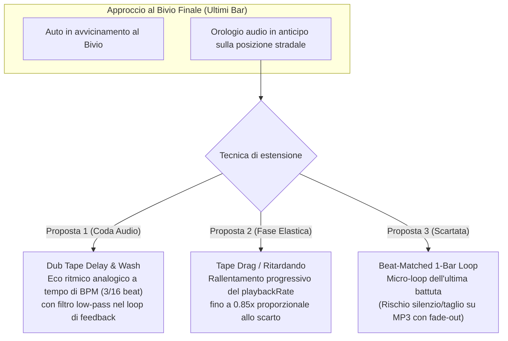

# 真夜中Cassette — Specifiche di Design e Piano di Implementazione: Prolungamento Organico dell'Outro

> **Documento di Analisi, Design e Specifiche Tecniche per la Sostituzione di `holdOutroLoop`**  
> *Riferimenti:* [`docs/DESIGN.md`](./DESIGN.md) §3, [`docs/SPACETIME_SYNC_PLAN.md`](./SPACETIME_SYNC_PLAN.md), [`AGENTS.md`](../AGENTS.md) §1 (Yu Suzuki Ethos)

---

## 1. Il Problema del Loop Attuale (`holdOutroLoop`)

### 1.1 Perché il loop grezzo di 8 battute fallisce musicalmente
L'attuale implementazione di `holdOutroLoop` in [`src/audio/FunkAudioEngine.ts`](../src/audio/FunkAudioEngine.ts) (`handleTrackEndWrap`, linee 816–836) intercetta la fine del file audio (`virtualTrackSec >= dur`) e, qualora l'auto si trovi nella finestra di approccio al bivio senza aver ancora superato la linea di fine stage, esegue:
```ts
const eightBarsSec = Math.min(dur * 0.5, 8 * barDurationSec(this.beatClock.map));
const loopStartSec = Math.max(0, dur - eightBarsSec);
this.virtualTrackSec = loopStartSec + ((this.virtualTrackSec - loopStartSec) % Math.max(1, eightBarsSec));
this.outroLoopHolding = true;
this.beatClock.resetCrossingState();
if (this.ctx && this.ctx.state === 'running' && !this.isSynthLoopBuffer) {
  this.startSourceNode(this.virtualTrackSec, 0.08);
}
```

Questo approccio presenta tre difetti strutturali:
1. **Salto indietro nel Drop (CD Skipping):** Nelle tracce bundled ([`BUNDLED_BEATMAPS`](../src/audio/FunkAudioEngine.ts)) la sezione `outro` dura **4 battute** (`startBar: 60, bars: 4`), ma `eightBarsSec` riavvolge di **8 battute** (`bar 56`), ripescando gli ultimi 4 bar del `drop` ad alta energia o strofe vocali già concluse.
2. **Stacco di fase su file reali (`!isSynthLoopBuffer`):** Ricreare l'`AudioBufferSourceNode` con un fade-in di soli `80 ms` taglia di netto la coda naturale del brano.
3. **Incoerenza con `src.loop = true`:** In `startSourceNode()`, `src.loop = true` è impostato sull'intero buffer; per il synth fallback (`isSynthLoopBuffer === true`), `handleTrackEndWrap` non aggiorna nemmeno l'offset del nodo hardware.

### 1.2 Il nuovo contesto con A1 e A2 (`SPACETIME_SYNC_PLAN.md`)
Con l'introduzione della **Sincronia Ibrida Spazio-Tempo**:
- **A1 (`computeElasticWorldSpeed`):** Modula il passo stradale entro $[0.84\times .. 1.25\times]$ per far coincidere l'arrivo al bivio (`this.track.length`) con la fine dell'outro (`totalBars * 4` beat).
- **A2 (`maybeStitchHorizonToMusic`):** Ricuce la pista all'orizzonte senza pop-in se il ritardo supera `1.75` battute.

Di conseguenza, **durante la guida attiva il giocatore arriva già puntuale al bivio**. Il bisogno di prolungare l'outro si manifesta esclusivamente nei casi limite in cui A1 raggiunge il suo tetto massimo (`1.25×`):
- Il giocatore rallenta drasticamente (`< 50 km/h` / `speedRatio < 0.25`) negli ultimi bar per osservare il bivio e leggere il `RadioSelector`;
- Il giocatore ferma completamente l'auto (`speed === 0`) prima del traguardo per godersi il panorama.

---

## 2. Le Tre Proposte di Prolungamento Organico



### Proposta 1: Dub Tape Delay & Reverb Wash (Coda d'Eco Analogica)
> *Ispirazione: Dub mixing giamaicano, Roland Space Echo RE-201, Vaporwave reverb drench.*

- **Meccanica:** Negli ultimi 2 bar della canzone, un bus parallelo di **Dub Tape Delay** sincronizzato al BPM (`3/16` di battuta = `0.75 * beatDurationSec`, classico *dotted eighth* dub/synthwave) inizia ad alimentarsi con gli ultimi accordi della traccia. Quando il file audio raggiunge la fine naturale (`virtualTrackSec >= dur`), la sorgente dry non salta indietro ma sfuma a zero, lasciando vibrare la coda rigenerativa del delay (filtrata passa-basso a `~950 Hz` con feedback alto `0.82`) finché il giocatore non attraversa il bivio.
- **Vantaggi:** Zero "CD skipping", funziona su qualsiasi file MP3/WAV utente, estetica 100% coerente con 真夜中Cassette.

### Proposta 2: Tape Drag & Organic Ritardando (Rallentamento del Nastro)
> *Ispirazione: Tape stop graduale, motore a cassetta sotto sforzo, pitch sag analogico.*

- **Meccanica:** Quando l'auto è nella zona di approccio al bivio (`holdOutroLoop === true`) e i beat stradali rimanenti (`roadBeatsRemaining`) superano i beat musicali rimanenti (`audioBeatsRemaining`), il motore riduce dolcemente il `playbackRate` della cassetta fino a un pavimento musicale di **`0.85×`** (`-15%`, circa `-2.8` semitoni):
  $$\text{outroDragRatio} = \text{clamp}\left(\frac{\text{audioBeatsRemaining}}{\max(0.5,\; \text{roadBeatsRemaining})}, \; 0.85, \; 1.0\right)$$
- **Vantaggi:** Lega fisicamente la decelerazione dell'auto in vista del bivio alla tensione del nastro magnetico (Design Pillar 2), allungando la durata fisica dell'outro del `~18%` senza alcun artefatto di taglio.

### Proposta 3: Beat-Matched 1-Bar DJ Loop (Scartata come soluzione primaria)
- **Perché scartata:** Sebbene mantenga la cassa dritta sui brani synth, sui file MP3 utente che terminano in *fade-out* o con una coda di riverbero ciclerebbe `1 bar` di quasi-silenzio o causerebbe click di fase ogni `~2 s`.

---

## 3. Matrice Comparativa

| Criterio | Proposta 1: Dub Tape Delay | Proposta 2: Tape Drag (`0.85×`) | Proposta 3: 1-Bar DJ Loop |
| :--- | :---: | :---: | :---: |
| **Continuità del Flow State** | ⭐⭐⭐⭐⭐ (Naturale & sognante) | ⭐⭐⭐⭐ (Tattile & reattivo) | ⭐⭐⭐ (Ritmico ma ripetitivo) |
| **Resa con Tracce Utente (MP3)** | ⭐⭐⭐⭐⭐ (Indipendente dalla traccia) | ⭐⭐⭐⭐⭐ (Zero tagli) | ⭐⭐ (Rischio silenzio su fade-out) |
| **Eliminazione "CD Skipping"** | 100% (Zero salti all'indietro) | 100% (Zero salti all'indietro) | 85% (Micro-loop percettibile) |
| **Aderenza al Tema Cassette/Vapor** | Massima (Roland Space Echo) | Massima (Nastro magnetico) | Media (CDJ moderno) |

---

## 4. Soluzione Scelta: Architettura Ibrida a 2 Stadi (Tape Drag + Dub Delay Wash)

La soluzione definitiva combina **Proposta 2 (Stadio 1: Tape Drag)** e **Proposta 1 (Stadio 2: Dub Tape Delay Wash)**:

1. **Stadio 1 — Avvicinamento Lento (`virtualTrackSec < dur` e `holdOutroLoop === true`):**
   - Mentre la canzone sta suonando gli ultimi bar prima del bivio, se l'auto procede lentamente e accumula ritardo rispetto ai beat rimanenti della traccia, `FunkAudioEngine` applica un **Tape Drag** progressivo fino a `0.85×` (`outroTapeDragMinRate = 0.85`).
   - Contemporaneamente, negli ultimi `2` bar prima di `dur`, il guadagno di mandata (`dubSendNode`) verso il circuito di **Dub Tape Delay** sale gradualmente da `0.0` a `0.55`, caricando la linea di ritardo con le ultime note/accordi del brano.
2. **Stadio 2 — Coda d'Eco alla Fine Naturale (`virtualTrackSec >= dur` e `holdOutroLoop === true`):**
   - La traccia **non salta mai indietro di 8 battute**.
   - Se la sorgente è un file audio reale (`!isSynthLoopBuffer`), `sourceGainNode` sfuma dolcemente a `0.0001` in `0.25 s` (evitando che il loop del buffer riparta dall'intro), mentre il **Dub Tape Delay** passa in rigenerazione sostenuta (`feedback = 0.84`, filtro passa-basso a `900 Hz`), mantenendo nell'aria una calda coda ritmica a `3/16` di beat.
   - Se la sorgente è il synth procedurale di fallback (`isSynthLoopBuffer === true`, che è già un loop continuo perfetto di 8 bar senza voci), il buffer continua a ciclare ma con filtro low-pass dub abbassato a `~950 Hz` e `dubSend` attivo per dare la stessa sensazione di sospensione "outro".
   - Nel frattempo `BeatClock` continua a pulsare regolarmente al BPM del brano (`virtualTrackSec` continua ad avanzare oltre `dur` per i calcoli di `beatPulse` e `judgeInputTimestamp`), così i cambi marcia e le luci al neon del bivio restano sincronizzati al battito.
   - Non appena l'auto supera il bivio (`crossfadeToTrack` o `loadTrack` o `holdOutroLoop` diventa `false`), la coda dub sfuma rapidamente a zero lasciando spazio al nuovo stage.

---

## 5. Specifiche Tecniche di Implementazione (Guida per l'Agente)

### 5.1 File Coinvolti

1. [`src/config/tuning.ts`](../src/config/tuning.ts) — Parametri live-tunable per Tape Drag e Dub Delay nel gruppo `'Audio'`.
2. [`src/audio/FunkAudioEngine.ts`](../src/audio/FunkAudioEngine.ts) — Grafo Web Audio del Dub Tape Delay, calcolo del Tape Drag in `update()`, sostituzione della logica di rewind in `handleTrackEndWrap()`.
3. [`src/engine/Game.ts`](../src/engine/Game.ts) — Passaggio dei beat stradali rimanenti (`roadBeatsRemaining`) in `DrivingAudioParams` per modulare il Tape Drag in modo proporzionale allo scarto reale.
4. [`src/engine/Game.test.ts`](../src/engine/Game.test.ts) — Aggiornamento e ampliamento dei test per verificare l'assenza di salti indietro (`virtualTrackSec` monotono durante l'outro hold), il Tape Drag e lo stato `isOutroLooping`.

---

### 5.2 Passo 1: Nuovi Parametri in [`src/config/tuning.ts`](../src/config/tuning.ts)

1. In `DEFAULT_TUNING` (sotto `// Audio & Beat Pulse (M3)`):
   ```ts
   outroTapeDragMinRate: 0.85,
   outroDubDelayFeedback: 0.82,
   outroDubFilterHz: 900,
   ```
2. In `TUNING_CONTROLS` (gruppo `'Audio'`):
   ```ts
   {
     group: 'Audio',
     key: 'outroTapeDragMinRate',
     label: 'Outro tape drag min',
     hint: 'Rallentamento minimo del nastro (playbackRate) quando indugi prima del bivio',
     unit: '×',
     min: 0.7,
     max: 1.0,
     step: 0.01,
   },
   {
     group: 'Audio',
     key: 'outroDubDelayFeedback',
     label: 'Outro dub feedback',
     hint: 'Rigenerazione della coda Space Echo quando la canzone finisce prima del bivio',
     min: 0.4,
     max: 0.92,
     step: 0.02,
   },
   {
     group: 'Audio',
     key: 'outroDubFilterHz',
     label: 'Outro dub cutoff',
     hint: 'Frequenza del filtro passa-basso nella coda d’eco dub dell’outro',
     unit: 'Hz',
     min: 400,
     max: 2400,
     step: 50,
   },
   ```

---

### 5.3 Passo 2: Estensione di `DrivingAudioParams` e Grafo Web Audio in [`src/audio/FunkAudioEngine.ts`](../src/audio/FunkAudioEngine.ts)

#### 2.1 Interfaccia `DrivingAudioParams`
Aggiungere il campo opzionale `roadBeatsRemaining` per consentire a `FunkAudioEngine` di confrontare i beat stradali mancanti al bivio con i beat audio mancanti alla fine della traccia:
```ts
export interface DrivingAudioParams {
  speedRatio: number;
  isDrifting: boolean;
  isOffRoad: boolean;
  offRoadDepth?: number;
  /**
   * True quando il giocatore è nella finestra finale di approccio al bivio su una playlist
   * multi-traccia: attiva il Tape Drag preventivo e la coda Dub Tape Delay se la traccia
   * giunge al termine prima dell'attraversamento del bivio (docs/OUTRO_EXTENSION_PROPOSALS.md).
   */
  holdOutroLoop?: boolean;
  /**
   * Beat stradali rimanenti fino alla linea di fine stage (`(track.length - position) / beatLengthWorld`).
   * Usato quando `holdOutroLoop === true` per modulare il Tape Drag (Proposta 2).
   */
  roadBeatsRemaining?: number;
}
```

#### 2.2 Topologia del Circuito Dub Tape Delay in `unlock()`
Nel metodo `unlock()` di `FunkAudioEngine`, quando viene inizializzato `this.ctx`, affiancare al percorso principale (`filterNode -> masterGain -> destination`) un anello di **Dub Delay** parallelo in uscita da `filterNode`:

```text
sourceNode -> sourceGainNode -> filterNode ──(dry)──────────────────────────────> masterGain -> destination
                                    │                                                 ▲
                                    └──> dubSendGain -> dubDelayNode -> dubFilterNode ┤
                                                             ▲                │
                                                             └── dubFeedback ─┘
```

Campi privati da aggiungere a `FunkAudioEngine`:
```ts
private dubSendGain: GainNode | null = null;
private dubDelayNode: DelayNode | null = null;
private dubFeedbackGain: GainNode | null = null;
private dubFilterNode: BiquadFilterNode | null = null;
private currentDubSend = 0;
private currentDubFeedback = 0;
private outroSourceFaded = false;
```

Inizializzazione dentro `unlock()` (protetta con verifiche opzionali `typeof ctx.createDelay === 'function'` per compatibilità coi mock minimali dei test unitari):
```ts
if (typeof ctx.createDelay === 'function') {
  const dubSend = ctx.createGain();
  dubSend.gain.value = 0;

  const dubDelay = ctx.createDelay(2.0);
  // 3/16 di battuta (dotted 8th note) sincronizzato al BPM corrente
  const dottedEighthSec = Math.max(0.08, Math.min(1.5, beatDurationSec(this.beatClock.map) * 0.75));
  dubDelay.delayTime.value = dottedEighthSec;

  const dubFilter = ctx.createBiquadFilter();
  dubFilter.type = 'lowpass';
  dubFilter.frequency.value = tuning.outroDubFilterHz;
  dubFilter.Q.value = 2.2;

  const dubFeedback = ctx.createGain();
  dubFeedback.gain.value = 0;

  filter.connect(dubSend);
  dubSend.connect(dubDelay);
  dubDelay.connect(dubFilter);
  dubFilter.connect(dubFeedback);
  dubFeedback.connect(dubDelay); // Loop rigenerativo
  dubFilter.connect(gain);       // Uscita wet dentro masterGain

  this.dubSendGain = dubSend;
  this.dubDelayNode = dubDelay;
  this.dubFilterNode = dubFilter;
  this.dubFeedbackGain = dubFeedback;
}
```

> [!NOTE]
> Aggiornare `dubDelay.delayTime.value` anche quando cambia il BPM in `loadTrack()`, `crossfadeToTrack()` e `updateBeatMap()` usando `Math.max(0.08, Math.min(1.5, beatDurationSec(beatMap) * 0.75))`.

#### 2.3 Calcolo del Tape Drag (Stadio 1) in `FunkAudioEngine.update()`
Prima del calcolo di `targetRate` (attorno alla linea 695 di `FunkAudioEngine.ts`):

1. Calcolare il fattore `outroDragDip`:
   ```ts
   const dur = Math.max(1, this.beatClock.map.durationSec);
   const audioSecRemaining = Math.max(0, dur - this.virtualTrackSec);
   const beatSec = beatDurationSec(this.beatClock.map);
   const audioBeatsRemaining = audioSecRemaining / beatSec;

   let outroDragTargetRate = 1.0;
   if (driving.holdOutroLoop) {
     if (this.outroLoopHolding) {
       // Stadio 2 attivo (coda dub): mantieni il nastro al minimo di drag configurato
       outroDragTargetRate = tuning.outroTapeDragMinRate;
     } else if (
       driving.roadBeatsRemaining !== undefined &&
       driving.roadBeatsRemaining > 0.5 &&
       audioBeatsRemaining < driving.roadBeatsRemaining
     ) {
       // Stadio 1: rallenta dolcemente il nastro se la strada rimasta supera i beat audio rimasti
       const ratio = audioBeatsRemaining / driving.roadBeatsRemaining;
       outroDragTargetRate = Math.max(
         tuning.outroTapeDragMinRate,
         Math.min(1.0, ratio),
       );
     }
   }
   const outroDragDip = 1.0 - outroDragTargetRate;
   ```
2. Integrare `outroDragDip` nel `targetRate`:
   ```ts
   const offRoadDip = this.offRoadEnvelope * tuning.audioOffRoadPitchDip;
   const targetRate = Math.max(0.65, 1.0 - offRoadDip - this.pitchDipEnvelope - outroDragDip);
   ```

#### 2.4 Gestione della Mandata Dub e di `handleTrackEndWrap` (Stadio 2 — Zero Rewind)
1. **Pre-caricamento della linea di ritardo (ultimi 2 bar):**
   In `FunkAudioEngine.update()`, calcolare i target per `dubSend` e `dubFeedback`:
   ```ts
   const twoBarsSec = 2 * barDurationSec(this.beatClock.map);
   const isPreOutroWindow = driving.holdOutroLoop === true && audioSecRemaining <= twoBarsSec;

   const targetDubSend = this.outroLoopHolding
     ? 0.0 // A traccia finita non immettiamo nuovo segnale dry nel delay: lasciamo risuonare la coda!
     : isPreOutroWindow
       ? 0.55 * (1 - audioSecRemaining / Math.max(0.1, twoBarsSec))
       : 0.0;

   const targetDubFeedback = this.outroLoopHolding
     ? tuning.outroDubDelayFeedback
     : isPreOutroWindow
       ? Math.min(0.68, tuning.outroDubDelayFeedback * 0.8)
       : 0.0;

   this.currentDubSend += (targetDubSend - this.currentDubSend) * (1 - Math.exp(-6.0 * dt));
   this.currentDubFeedback += (targetDubFeedback - this.currentDubFeedback) * (1 - Math.exp(-6.0 * dt));
   ```
   Se `this.isSynthLoopBuffer` è `true` quando `this.outroLoopHolding` è `true` (caso synth procedurale di fallback), mantenere `targetDubSend = 0.45` così il loop synth alimenta continuamente l'eco dub.
   Applicare `this.currentDubSend`, `this.currentDubFeedback` e `tuning.outroDubFilterHz` ai rispettivi nodi Web Audio (`dubSendGain`, `dubFeedbackGain`, `dubFilterNode`) se presenti.

2. **Sostituzione di `handleTrackEndWrap(dur: number, holdOutroLoop: boolean)`:**
   ```ts
   private handleTrackEndWrap(dur: number, holdOutroLoop: boolean): void {
     if (holdOutroLoop) {
       // NESSUN SALTO INDIETRO DI 8 BATTUTE!
       // Attiva lo Stadio 2 (Dub Tape Delay Hold): virtualTrackSec continua ad avanzare
       // linearmente così BeatClock mantiene il battito costante fino al bivio.
       this.outroLoopHolding = true;
       if (
         !this.outroSourceFaded &&
         !this.isSynthLoopBuffer &&
         this.ctx &&
         this.sourceGainNode &&
         this.ctx.state === 'running'
       ) {
         // Sfuma il buffer dry dell'MP3 per evitare che `src.loop = true` riparta dall'intro
         const now = this.ctx.currentTime;
         this.outroSourceFaded = true;
         try {
           this.sourceGainNode.gain.cancelScheduledValues(now);
           this.sourceGainNode.gain.setValueAtTime(
             Math.max(0.01, this.sourceGainNode.gain.value),
             now,
           );
           this.sourceGainNode.gain.linearRampToValueAtTime(0.0001, now + 0.25);
         } catch {
           // Ignore scheduling errors on disposed/mocked nodes
         }
       }
     } else {
       const wasHoldingOutro = this.outroLoopHolding;
       this.virtualTrackSec %= dur;
       this.outroLoopHolding = false;
       this.outroSourceFaded = false;
       this.beatClock.resetCrossingState();
       if (wasHoldingOutro && this.ctx && this.ctx.state === 'running' && !this.isSynthLoopBuffer) {
         this.startSourceNode(this.virtualTrackSec, 0.08);
       }
     }
   }
   ```
3. **Filtro principale durante `outroLoopHolding`:**
   In `FunkAudioEngine.update()` (calcolo di `targetCutoff`), se `this.outroLoopHolding` è `true`, limitare superiormente `targetCutoff` a `Math.min(targetCutoff, tuning.outroDubFilterHz * 1.35)` così anche l'eventuale synth loop di sottofondo assume un timbro caldo, notturno e sospeso.
4. **Reset pulito in `loadTrack()` e `crossfadeToTrack()`:**
   Resettare `this.outroLoopHolding = false`, `this.outroSourceFaded = false`, `this.currentDubSend = 0`, `this.currentDubFeedback = 0` quando inizia un nuovo brano o un crossfade al bivio.

---

### 5.4 Passo 3: Integrazione in [`src/engine/Game.ts`](../src/engine/Game.ts)

In `Game.update(dt)` (attorno alle linee 741–752), oltre a impostare `this.drivingAudioParams.holdOutroLoop`, calcolare e passare `roadBeatsRemaining`:

```ts
const forkApproachWindowBars = Math.max(
  4,
  Math.min(FORK_APPROACH_BARS + 4, Math.floor(this.totalBars * 0.5)),
);
const holdOutro =
  this.library.hasMultipleTracks &&
  !this.hasCustomTrack &&
  this.roadBarIndex >= this.totalBars - forkApproachWindowBars &&
  this.roadBarIndex < Math.max(1, this.totalBars - 2);

this.drivingAudioParams.holdOutroLoop = holdOutro;
if (holdOutro && isSongTrack(this.track)) {
  const totalRoadBeats = this.track.totalBars * 4;
  const currentRoadBeat = worldZToBeat(this.track, this.position);
  this.drivingAudioParams.roadBeatsRemaining = Math.max(0, totalRoadBeats - currentRoadBeat);
} else {
  this.drivingAudioParams.roadBeatsRemaining = undefined;
}
```

> [!IMPORTANT]
> Rimuovere la condizione restrittiva `this.roadBarIndex < Math.max(1, this.totalBars - 2)` **oppure** estenderla fino a `this.position < this.track.length`: se il giocatore si ferma esattamente a `totalBars - 1` (dentro le corsie del bivio, prima della linea del traguardo), `holdOutroLoop` deve restare `true` finché l'auto non varca effettivamente la linea di fine stage (`handleStageOrLapEnd`), altrimenti la musica farebbe un wrap brusco all'intro proprio a 10 metri dal traguardo!
> Pertanto la condizione corretta è:
> ```ts
> const holdOutro =
>   this.library.hasMultipleTracks &&
>   !this.hasCustomTrack &&
>   this.roadBarIndex >= this.totalBars - forkApproachWindowBars &&
>   this.position < this.track.length;
> ```

---

### 5.5 Passo 4: Piano di Verifica e Test (`vitest`)

1. **Test in [`src/engine/Game.test.ts`](../src/engine/Game.test.ts):**
   - **Aggiornare il test esistente** `holds the 8-bar DJ outro loop when the song reaches the end before the player reaches the fork`:
     - Verificare che quando `virtualTrackSec` supera `durationSec` con `holdOutroLoop: true`, `engine.isOutroLooping` diventi `true` e **`virtualTrackSec` NON venga riavvolto indietro di 8 battute** (`virtualTrackSec >= durationSec`), eliminando il bug del "CD skipping".
     - Verificare che `BeatClock` continui a campionare beat validi e monotoni anche durante l'outro hold.
   - **Aggiungere test per il Tape Drag (Stadio 1):**
     - Con `holdOutroLoop: true`, `roadBeatsRemaining: 16` e `audioBeatsRemaining: 8` (giocatore in ritardo negli ultimi bar), verificare che `engine.playbackRate` scenda dolcemente verso `tuning.outroTapeDragMinRate` (`0.85`) senza scendere sotto il limite configurato.
   - **Verificare il mantenimento fino al traguardo:**
     - Verificare che se il giocatore si ferma dentro gli ultimi 2 bar del bivio (`roadBarIndex === totalBars - 1`), `holdOutroLoop` resti `true` fino all'attraversamento di `track.length`.
2. **Controllo Qualità Completo (`npm run check`):**
   - Eseguire `npm run lint`, `npm test -- --run` e `npm run build` verificando zero errori TypeScript, zero warning ESLint e il passaggio di tutta la suite Vitest.
