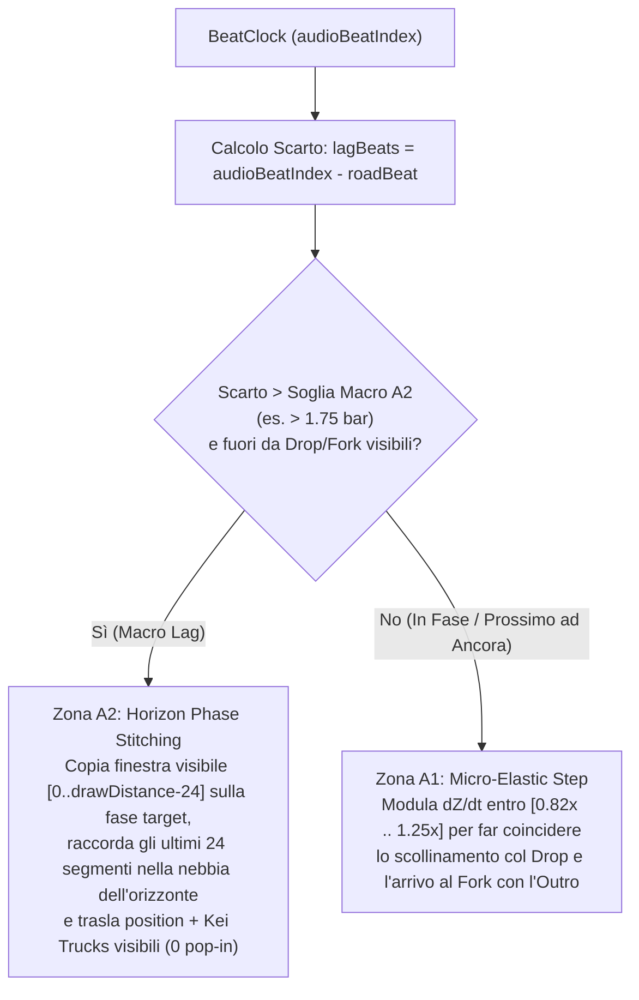

# Piano di Implementazione: Sincronia Ibrida Spazio-Tempo (A1 + A2)

## 1. Obiettivo e Contesto Architetturale

Attualmente la generazione della pista ([`SongRoadGenerator.ts`](file:///c:/Users/USER/Documents/Codice/Game%20Dev/outrun-futurefunk/src/road/SongRoadGenerator.ts)) converte le battute musicali (`totalBars`) in una distanza fissa basata su una velocità costante (`referenceSpeedRatio = 0.85`), mentre l'orologio musicale ([`FunkAudioEngine.ts`](file:///c:/Users/USER/Documents/Codice/Game%20Dev/outrun-futurefunk/src/audio/FunkAudioEngine.ts)) avanza in tempo reale. Qualsiasi rallentamento (partenza da fermo `0 → 4ª marcia`, guida rilassata in 3ª marcia, curve da `breakdown`, escursioni fuoristrada o collisioni) accumula un ritardo spaziale $\Delta Z$ irreversibile che:
1. Fa arrivare il giocatore in ritardo sulle creste dei `drop` (`dropMarkers`).
2. Fa terminare la canzone prima che l'auto raggiunga il bivio finale (`fork`), attivando sistematicamente il loop forzato dell'outro (`holdOutroLoop`).

### Architettura della Soluzione Ibrida (A1 + A2)
Manteniamo invariata la struttura deterministica di `SongTrack` (`track.length === track.segments.length * track.segmentLength`, `barLengthWorld` costante, coordinate canoniche di `dropMarkers` e `forkZoneStartZ`), introducendo un controller a due zone separato dalla linea dell'orizzonte (`drawDistance`):



---

## 2. File Coinvolti

1. [`src/config/tuning.ts`](file:///c:/Users/USER/Documents/Codice/Game%20Dev/outrun-futurefunk/src/config/tuning.ts) — Nuovi parametri di tuning per il passo elastico (A1), la soglia di riallineamento all'orizzonte (A2) e calibrazione di `referenceSpeedRatio`.
2. [`src/road/SongRoadGenerator.ts`](file:///c:/Users/USER/Documents/Codice/Game%20Dev/outrun-futurefunk/src/road/SongRoadGenerator.ts) — Snapshot canonico immutabile dei segmenti in `SongTrack`, funzione di profilo velocità per ruolo (`getSectionPaceFactor`) e funzioni zero-GC `stitchHorizonToBar()` / `restoreCanonicalTrack()`.
3. [`src/entities/TrafficAndProps.ts`](file:///c:/Users/USER/Documents/Codice/Game%20Dev/outrun-futurefunk/src/entities/TrafficAndProps.ts) — Metodo `shiftVisibleWindowTrucks()` per traslare senza pop-in i Kei Truck attualmente visibili durante uno stitch A2.
4. [`src/engine/Game.ts`](file:///c:/Users/USER/Documents/Codice/Game%20Dev/outrun-futurefunk/src/engine/Game.ts) — Integrazione del calcolo `computeElasticStepScale()` (A1) e del trigger `maybeStitchHorizon()` (A2) dentro `update(dt)`.
5. [`src/road/SongRoadGenerator.test.ts`](file:///c:/Users/USER/Documents/Codice/Game%20Dev/outrun-futurefunk/src/road/SongRoadGenerator.test.ts) & [`src/engine/Game.test.ts`](file:///c:/Users/USER/Documents/Codice/Game%20Dev/outrun-futurefunk/src/engine/Game.test.ts) — Unit test per A1, A2 e continuità visiva.

---

## 3. Specifiche Tecniche Passo-Passo

### Passo 1: Parametri in [`src/config/tuning.ts`](file:///c:/Users/USER/Documents/Codice/Game%20Dev/outrun-futurefunk/src/config/tuning.ts)

1. In `DEFAULT_TUNING` (gruppo `Song Road`):
   - Abbassare `referenceSpeedRatio` da `0.85` a **`0.76`** (così la 3ª marcia a `0.82` e la 4ª marcia a `0.85–1.00` tengono naturalmente il passo base senza richiedere guida al limite).
   - Aggiungere:
     - `syncElasticGain: 0.12` — Guadagno proporzionale del riallineamento micro A1 per ogni battito di scarto.
     - `syncMaxSpeedup: 0.25` — Accelerazione elastica massima del passo stradale (`1 + 0.25 = 1.25×` velocità auto).
     - `syncMaxSlowdown: 0.16` — Rallentamento elastico massimo del passo stradale (`1 - 0.16 = 0.84×` velocità auto).
     - `syncHorizonStitchBars: 1.75` — Soglia di ritardo in battute (`bars`) oltre la quale scatta la ricucitura invisibile all'orizzonte (A2).
2. Esporre i nuovi controlli in `TUNING_CONTROLS` sotto il gruppo `'Song Road'` per renderli regolabili dal vivo nel `DebugPanel` (`F2`).

---

### Passo 2: Blueprint Canonico e Ricucitura Orizzonte (A2) in [`src/road/SongRoadGenerator.ts`](file:///c:/Users/USER/Documents/Codice/Game%20Dev/outrun-futurefunk/src/road/SongRoadGenerator.ts)

#### 2.1 Estensione dell'interfaccia `SongTrack`
Salvare i valori geometrici originali generati dal seed in array tipizzati pre-allocati (zero GC a runtime), così da poter ripristinare o ricucire i segmenti in qualsiasi momento:

```ts
export interface CanonicalSegmentData {
  /** Curvatura originale di ciascun segmento (lunghezza = segments.length). */
  readonly curve: Float32Array;
  /** Quota worldY di p1 per ciascun segmento (lunghezza = segments.length). */
  readonly p1WorldY: Float32Array;
  /** Quota worldY di p2 per ciascun segmento (lunghezza = segments.length). */
  readonly p2WorldY: Float32Array;
  /** Copia immutabile delle liste di sprite originali per segmento. */
  readonly sprites: readonly (readonly RoadSprite[])[];
}

export interface SongTrack extends Track {
  // ... campi esistenti invariati ...
  readonly canonical: CanonicalSegmentData;
}
```

Popolare `canonical` alla fine di [`generateSongRoad`](file:///c:/Users/USER/Documents/Codice/Game%20Dev/outrun-futurefunk/src/road/SongRoadGenerator.ts#L253-L266).

#### 2.2 Fattore di passo per ruolo sezione (`getSectionPaceFactor`)
Aggiungere una funzione pura che restituisce il ritmo naturale di percorrenza della sezione corrente:

```ts
export function getSectionPaceFactor(
  track: SongTrack,
  barIndex: number,
  sectionRole: SectionRole,
): number
```
- Primi 4 bar assoluti della traccia (`barIndex < 4`, fase di lancio da `0 km/h`): rampa lineare da `0.55` a `0.85`.
- Sezione `breakdown` (curve a gomito e derapate): `0.86`.
- Sezioni `intro` (dopo bar 4) e `outro`: `0.92`.
- Sezioni `build` e `drop`: `1.00`.

#### 2.3 Funzione `stitchHorizonToTargetZ` (Livello Macro A2 — Zero Pop-in)
Quando l'auto si trova a `currentZ` e deve essere riallineata in avanti a `rawTargetZ` (perché indietro di oltre `syncHorizonStitchBars` battute rispetto alla musica):

```ts
export interface HorizonStitchResult {
  /** Delta Z (in world units, multiplo esatto di 2 * RUMBLE_LENGTH * segmentLength) applicato a position. */
  deltaZ: number;
  /** Indice segmento di partenza prima dello stitch. */
  fromSegIndex: number;
  /** Indice segmento di arrivo dopo lo stitch. */
  toSegIndex: number;
  /** Numero di segmenti della finestra visibile copiati in-place. */
  copiedWindowSegs: number;
}

export function stitchHorizonToTargetZ(
  track: SongTrack,
  currentZ: number,
  rawTargetZ: number,
  drawDistance: number,
): HorizonStitchResult | null
```

**Algoritmo di continuità visiva C1 (nessun pixel cambia sullo schermo):**
1. Calcolare `fromSegIndex = Math.floor(currentZ / track.segmentLength)` e `rawDeltaSegs = Math.floor((rawTargetZ - currentZ) / track.segmentLength)`.
2. Quantizzare `deltaSegs` al multiplo intero più vicino di `2 * RUMBLE_LENGTH` (`6` segmenti):
   $$\Delta i = 6 \cdot \text{round}\left(\frac{\text{rawDeltaSegs}}{6}\right)$$
   > [!IMPORTANT]
   > Poiché $\Delta i$ è multiplo di $2 \times \text{RUMBLE\_LENGTH}$, la parità `seg.stripe` (`0` o `1`) e il resto frazionario `position % segmentLength` prima e dopo la traslazione sono **identici al 100%**.
3. Verificare i vincoli di sicurezza:
   - $\Delta i \ge 12$ (almeno 12 segmenti di correzione).
   - `toSegIndex = fromSegIndex + deltaSegs` deve lasciare almeno `drawDistance + 16` segmenti prima della fine della pista (`toSegIndex + drawDistance + 16 < track.segments.length`).
4. Dividere la finestra `[0 .. drawDistance - 1]` in due sotto-zone:
   - **Zona Solida Visibile (`0 .. copyCount - 1`, dove `copyCount = drawDistance - 24`):**
     Per ogni $n \in [0, \text{copyCount} - 1]$:
     - Calcolare l'offset verticale costante $\Delta Y = \text{canonical.p1WorldY}[toSegIndex] - \text{seg}[fromSegIndex].p1.worldY$.
     - Copiare `curve` da `seg[fromSegIndex + n]` a `seg[toSegIndex + n]`.
     - Copiare `p1.worldY = seg[fromSegIndex + n].p1.worldY + deltaY` e `p2.worldY = seg[fromSegIndex + n].p2.worldY + deltaY`.
     - Copiare i riferimenti di `sprites` da `seg[fromSegIndex + n]` a `seg[toSegIndex + n]` (preservando eventuali cartelloni `billboard` dei `dropMarkers`).
   - **Zona di Raccordo nella Nebbia dell'Orizzonte (`copyCount .. drawDistance - 1`, ultimi 24 segmenti dove `fog < 0.05`):**
     - Raccordare con `easeInOut(t)` la quota `worldY` e la `curve` dall'ultimo segmento copiato (`toSegIndex + copyCount - 1`) alla quota e curvatura canonica di `canonical[toSegIndex + drawDistance]`.
     - Ripristinare per tutti i segmenti $\ge toSegIndex + drawDistance$ i valori di `track.canonical` così che ciò che emerge dall'orizzonte nei secondi successivi sia la geometria canonica esatta della canzone.
5. Restituire `{ deltaZ: deltaSegs * track.segmentLength, fromSegIndex, toSegIndex, copiedWindowSegs: copyCount }`.

#### 2.4 Funzione `restoreCanonicalTrack(track: SongTrack)`
Ripristina in un ciclo lineare (zero allocazioni) `curve`, `p1.worldY`, `p2.worldY` e `sprites` di tutti i segmenti leggendo `track.canonical`. Va chiamata in [`Game.ts`](file:///c:/Users/USER/Documents/Codice/Game%20Dev/outrun-futurefunk/src/engine/Game.ts) quando la traccia finisce un giro (`handleStageOrLapEnd`) o viene resettata.

---

### Passo 3: Traslazione Coerente del Traffico in [`src/entities/TrafficAndProps.ts`](file:///c:/Users/USER/Documents/Codice/Game%20Dev/outrun-futurefunk/src/entities/TrafficAndProps.ts)

Aggiungere a `TrafficManager` il metodo:

```ts
shiftVisibleWindowTrucks(
  track: Track,
  fromZ: number,
  deltaZ: number,
  windowWorldSpan: number,
): void
```
- Quando A2 esegue uno stitch di $+\Delta Z$:
  1. I Kei Truck che si trovano già dentro la finestra visibile `[fromZ + deltaZ, fromZ + deltaZ + windowWorldSpan]` (nella zona di destinazione) vengono spostati fuori dalla finestra visibile (es. oltre l'orizzonte `+ windowWorldSpan`) per evitare che compaiano dal nulla davanti al giocatore.
  2. I Kei Truck che il giocatore stava effettivamente vedendo in `[fromZ, fromZ + windowWorldSpan]` vengono traslati di $+\Delta Z$ (aggiornando `truck.z` e `truck.segmentIndex`), così i furgoncini davanti al cofano rimangono esattamente alla stessa distanza visiva.

---

### Passo 4: Orchestrazione A1 + A2 in [`src/engine/Game.ts`](file:///c:/Users/USER/Documents/Codice/Game%20Dev/outrun-futurefunk/src/engine/Game.ts)

#### 4.1 Livello Micro A1 (`computeElasticWorldSpeed`)
In `Game.update(dt)`, sostituire l'avanzamento rigido `const nextPos = this.position + this.car.speed * dt` ([`Game.ts:421`](file:///c:/Users/USER/Documents/Codice/Game%20Dev/outrun-futurefunk/src/engine/Game.ts#L421)) con il calcolo del passo elastico:

1. Se `!isSongTrack(this.track)` oppure `this.hasCustomTrack` oppure `this.car.speedRatio < 0.05`:
   - Usare `effectiveSpeed = this.car.speed` (nessuna alterazione a macchina ferma o su piste test non musicali).
2. Altrimenti:
   - Calcolare il fattore di sezione `paceFactor = getSectionPaceFactor(this.track, this.roadBarIndex, this.sectionRole)`.
   - **Convergenza su Ancora Visibile (Prossimo Drop o Bivio Finale):**
     - Cercare il prossimo `dropMarker` non ancora attraversato entro `8` battute (`32` beat), oppure la fine della pista (`this.track.length` / `this.totalBars * 4` beat) quando mancano meno di `FORK_APPROACH_BARS + 2` battute.
     - Se esiste un'ancora imminente con `beatsRemaining > 0.4` e `distRemaining > 0`:
       $$\text{timeRemainingSec} = \text{beatsRemaining} \cdot \frac{60}{\text{bpm}}$$
       $$v_{\text{target}} = \frac{\text{distRemaining}}{\text{timeRemainingSec}}$$
       Calcolare il rapporto $r = v_{\text{target}} / \max(1, \text{car.speed})$ e limitarlo dolcemente in `[1 - tuning.syncMaxSlowdown, 1 + tuning.syncMaxSpeedup]`.
   - **Riallineamento Continuo tra Ancore:**
     - Se non c'è un'ancora entro 8 battute, calcolare `lagBeats = this.audioBeatIndex - worldZToBeat(this.track, this.position)`.
     - Calcolare:
       $$\text{scale} = \text{clamp}\left(\frac{1}{\text{paceFactor}} + \text{lagBeats} \cdot \text{tuning.syncElasticGain}, \; 1 - \text{tuning.syncMaxSlowdown}, \; 1 + \text{tuning.syncMaxSpeedup}\right)$$
   - `effectiveSpeed = this.car.speed * scale`.

#### 4.2 Livello Macro A2 (`maybeStitchHorizonToMusic`)
Chiamato in `Game.update(dt)` subito dopo l'aggiornamento del `BeatClock`:
1. Condizioni di attivazione:
   - `isSongTrack(this.track)` e `!this.hasCustomTrack`
   - `this.car.speedRatio >= 0.12` (l'auto è in marcia)
   - `!this.forkActive` (non siamo già dentro il bivio finale)
   - Un cooldown minimo di `1.5s` dall'ultimo stitch (`this.horizonStitchCooldown <= 0`)
   - Non c'è un `dropMarker` già visibile a meno di `drawDistance * 0.75` segmenti davanti all'auto.
2. Calcolo dello scarto:
   - `audioBarFloat = this.audioBeatIndex / 4`
   - `roadBarFloat = this.position / this.track.barLengthWorld`
   - `lagBars = audioBarFloat - roadBarFloat`
3. Trigger:
   - Se `lagBars >= tuning.syncHorizonStitchBars` (oppure se la canzone è entrata nelle ultime `FORK_APPROACH_BARS + 2` battute e `this.totalBars - roadBarFloat > FORK_APPROACH_BARS + 2.5`):
     - Calcolare `targetZ = Math.min(this.track.length - (FORK_APPROACH_BARS + 1) * this.track.barLengthWorld, audioBarFloat * this.track.barLengthWorld)`.
     - Eseguire `const res = stitchHorizonToTargetZ(this.track, this.position, targetZ, Math.floor(tuning.drawDistance))`.
     - Se `res !== null`:
       - `this.traffic.shiftVisibleWindowTrucks(this.track, this.position, res.deltaZ, res.copiedWindowSegs * this.track.segmentLength)`
       - `this.position += res.deltaZ`
       - `this.prevPosition += res.deltaZ`
       - `this.horizonStitchCooldown = 1.5`
4. In `handleStageOrLapEnd`:
   - Se `isSongTrack(this.track)`, chiamare `restoreCanonicalTrack(this.track)` quando si ricomincia il giro (loop della stessa traccia).

---

## 4. Piano di Verifica e Test (`vitest`)

1. **Test Unitari in [`src/road/SongRoadGenerator.test.ts`](file:///c:/Users/USER/Documents/Codice/Game%20Dev/outrun-futurefunk/src/road/SongRoadGenerator.test.ts):**
   - Verificare che tutti i test esistenti passino senza modifiche.
   - Aggiungere test per `stitchHorizonToTargetZ`:
     - Verificare che `deltaZ` sia sempre multiplo esatto di `2 * RUMBLE_LENGTH * segmentLength`.
     - Verificare che per tutti i segmenti visibili `n = 0 .. copiedWindowSegs - 1` la curvatura `curve`, la parità `stripe` e il profilo di elevazione relativo `p2.worldY - p1.worldY` prima e dopo lo stitch coincidano al 100%.
     - Verificare che la zona di raccordo all'orizzonte non abbia discontinuità verticali (`seg[i].p1.worldY === seg[i - 1].p2.worldY` su tutta la pista).
     - Verificare che `restoreCanonicalTrack` riporti ogni segmento esattamente ai valori iniziali.

2. **Test d'Integrazione in [`src/engine/Game.test.ts`](file:///c:/Users/USER/Documents/Codice/Game%20Dev/outrun-futurefunk/src/engine/Game.test.ts):**
   - **Test Guida Rilassata / Collisioni (A1 + A2):** Simulare una run in cui il giocatore parte da fermo e guida a velocità ridotta (`60%–70%` di `maxSpeed`, ben sotto il vecchio `85%`) subendo rallentamenti:
     - Verificare che grazie allo stitch all'orizzonte (A2) e al micro-step elastico (A1) l'auto attraversi i `dropMarkers` in sincrono con il `BeatClock` (`|deltaBeats| <= 1.25`, emettendo l'evento `dropSync`).
     - Verificare che l'auto raggiunga il bivio finale e completi lo stage senza mai restare intrappolata in `isOutroLooping`.
   - Verificare con `npm run check` (`eslint`, `vitest run`, `tsc --noEmit && vite build`) che non ci siano errori di linting, tipi o build.
